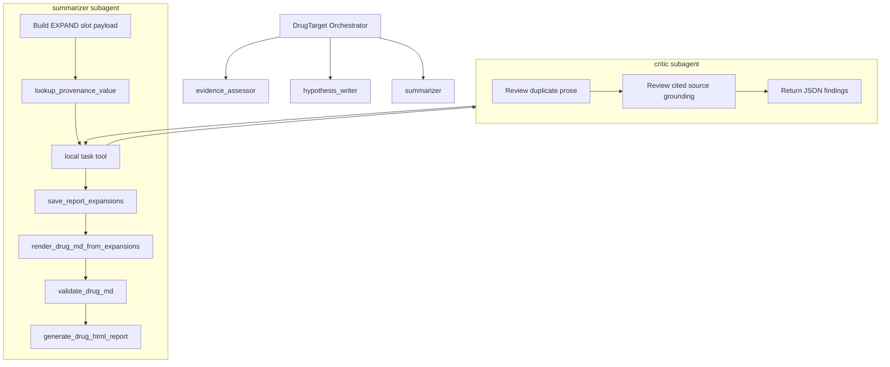
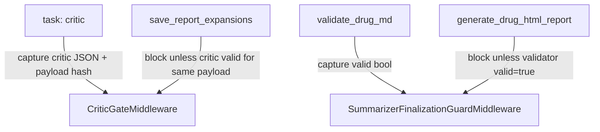

# Implementation Plan: drug_target Summarizer-Local Critic Subagent Replan

> Created: 2026-05-15
> Status: Approved
> Evaluation Score: N/A (restructured from approved RALPLAN-DR plan)

## 1. User Requirements

### 1.1 Requirement Summary

Replace the proposed heuristic `src/agents/drug_target/tools/critic.py` tool with a simple summarizer-local `critic` subagent. The critic reviews the full EXPAND slot payload before `save_report_expansions`, returns structured JSON findings, and never writes files. A `CriticGateMiddleware` blocks `save_report_expansions` unless the most recent critic result is valid for the exact payload being saved.

### 1.2 Detailed Requirements

**Top-level workflow stability**
- Default top-level workflow remains three primary subagents: `evidence_assessor`, `hypothesis_writer`, `summarizer`.
- `critic` is available only inside the summarizer via summarizer-local task delegation, not as a top-level orchestrator step.
- No new `src/agents/drug_target/tools/critic.py` is introduced.

**Canonical hash consolidation**
- All payload hashing in `CriticGateMiddleware`, critic-envelope generation, tests, and `HypothesisRetryLoopMiddleware` uses `canonical_json_hash` from `src/agents/drug_target/tools/report_expansion_schema.py`.
- `_canonical_payload_hash` is deleted from `src/agents/drug_target/subagents/summarizer/middleware.py`; `grep -rn '_canonical_payload_hash' src/agents/drug_target/` returns zero matches.

**Factory and model wiring**
- `get_subagents()` passes the real backend and default/critic model into `get_summarizer_subagent()`; nested `SubAgentMiddleware` setup is not optional.
- Critic model routing is concrete: `DrugTargetConfig.__post_init__` includes `"critic"` in `load_subagent_models_from_env([...])`; `get_subagents()` resolves `critic_model = model_overrides.get("critic") or model_overrides.get("summarizer") or default_model`; `get_summarizer_subagent(..., critic_model=critic_model)` passes that explicit model to `get_critic_subagent()`.

**Kill switch propagation**
- `DrugTargetConfig.critic_enabled: bool = field(default_factory=_critic_enabled_default_from_env)` is the single kill-switch mechanism. The default factory parses `DRUG_TARGET_CRITIC_ENABLED` fail-closed; an explicit caller-provided bool overrides the env because dataclass default factories run only when the argument is omitted.
- `config.critic_enabled` is threaded explicitly through `create_drug_target_agent(...) -> get_subagents(..., critic_enabled=config.critic_enabled) -> get_summarizer_subagent(..., critic_enabled=critic_enabled)` so the kill switch controls both middleware installation and prompt assembly.

**Gate enforcement**
- `save_report_expansions` is blocked until critic returns `valid=true` for the same canonical slot payload.
- `generate_drug_html_report` remains blocked until `validate_drug_md` returns `valid=true`.

**Critic contract**
- Critic returns parseable JSON containing `valid`, `findings`, `findings_count`, `payload_hash`, and per-finding `finding_type`, `severity`, `slot_ids`, `sentence`, `reason`, `repair_instruction`.
- Critic task descriptions use `schema_version="summarizer_critic_review.v1"` and contain a parseable `payload` object.
- Critic/save payload hashes are computed over the same normalized `ReportExpansionsPayload` representation, including the `reference_card_hash` omitted/auto-derived case.
- Critic envelopes include only cited provenance entries, not full provenance indexes.
- Critic prompt explicitly forbids judging whether a medical claim is generally true; it may only judge whether cited source/provenance text supports the sentence.
- Critic prompt draft exists in Appendix A, is <=2000 tokens, references `schema_version="summarizer_critic_review.v1"`, and includes one passing and one rejecting worked example.

**Legacy prompt and persisted-report boundary**
- Existing legacy `CRITIC_PROMPT` is replaced or renamed so `SUBAGENT_PROMPTS["critic"]` does not expose an incompatible old schema.
- `REPORT_WRITER_PROMPT` and any dead `report_writer` prompt exports/references are removed if they are not still used.
- `validate_drug_report_finalization(require_critic=True)` remains a legacy persisted-report compatibility path and is not used by the new pre-save summarizer gate.

**State isolation**
- `CriticGateMiddleware` and `SummarizerFinalizationGuardMiddleware` state are reset per summarizer run via `before_agent`, or keyed by active tool-call/thread context so stale critic/validator results cannot leak between runs.
- `CriticGateMiddleware` captures critic output from both direct `ToolMessage` and real DeepAgents `Command.update["messages"]` return paths.
- The save-time gate hashes `request.tool_call["args"]["expansions"]` before `handler(request)` runs; a code comment documents that `save_report_expansions` mutates `reference_card_hash` later during validation.

**Test and verification coverage**
- Round-trip regression tests cover duplicate prose, ungrounded medical claim, payload mutation after critic pass, critic JSON malformed output, disabled critic mode, and validator-after-critic repair loop.
- `uv run pytest tests/agents/drug_target/ -m "not llm"` passes for deterministic CI and finishes in <60s on a normal development machine.
- `uv run pytest tests/agents/drug_target/ -m llm` passes against the configured critic model before live-smoke evidence is claimed.
- `ruff check src/agents/drug_target/ tests/agents/drug_target/` passes.
- `pyright src/agents/drug_target/` passes.

### 1.3 Scope and Constraints

**Principles**

1. Keep the top-level drug_target workflow stable: orchestrator -> evidence_assessor -> hypothesis_writer -> summarizer.
2. Put prose-review responsibility next to the writer: critic is summarizer-local, not a fourth top-level stage.
3. Separate judgment from enforcement: critic subagent reviews; middleware enforces review-before-save and validate-before-finalize.
4. Avoid heuristic medical vocabulary maintenance unless it proves necessary later.
5. Fail closed on unreviewed or changed payloads while preserving a kill switch for weak-model deployments.
6. Let middleware own machine invariants; never depend on the summarizer LLM or critic LLM to compute payload hashes correctly.
7. Keep deterministic CI independent from LLM-dependent reviewer behavior.

**Decision Drivers**

1. Reduce false positives from morphology/synonym/paraphrase mismatches in the original heuristic `critic.py` plan.
2. Preserve PR #19's simplification: no compiled inner graph, no report_writer revival, no Python repair loop.
3. Keep verification mechanical enough that weak summarizer models cannot skip review and still save/finalize.
4. Eliminate duplicate canonical-hash helpers so the critic/save gate cannot fail from serializer drift.

### 1.4 Acceptance Criteria

- [ ] Default top-level workflow remains three primary subagents: `evidence_assessor`, `hypothesis_writer`, `summarizer`.
- [ ] `critic` is available only inside the summarizer via summarizer-local task delegation, not as a top-level orchestrator step.
- [ ] No new `src/agents/drug_target/tools/critic.py` is introduced.
- [ ] All payload hashing in `CriticGateMiddleware`, critic-envelope generation, tests, and `HypothesisRetryLoopMiddleware` uses `canonical_json_hash` from `src/agents/drug_target/tools/report_expansion_schema.py`.
- [ ] `_canonical_payload_hash` is deleted from `src/agents/drug_target/subagents/summarizer/middleware.py`; `grep -rn '_canonical_payload_hash' src/agents/drug_target/` returns zero matches.
- [ ] `get_subagents()` passes the real backend and default/critic model into `get_summarizer_subagent()`; nested `SubAgentMiddleware` setup is not optional.
- [ ] Critic model routing is concrete: `DrugTargetConfig.__post_init__` includes `"critic"` in `load_subagent_models_from_env([...])`; `get_subagents()` resolves `critic_model = model_overrides.get("critic") or model_overrides.get("summarizer") or default_model`; `get_summarizer_subagent(..., critic_model=critic_model)` passes that explicit model to `get_critic_subagent()`.
- [ ] `DrugTargetConfig.critic_enabled: bool = field(default_factory=_critic_enabled_default_from_env)` is the single kill-switch mechanism. The default factory parses `DRUG_TARGET_CRITIC_ENABLED` fail-closed; an explicit caller-provided bool overrides the env because dataclass default factories run only when the argument is omitted.
- [ ] `config.critic_enabled` is threaded explicitly through `create_drug_target_agent(...) -> get_subagents(..., critic_enabled=config.critic_enabled) -> get_summarizer_subagent(..., critic_enabled=critic_enabled)` so the kill switch controls both middleware installation and prompt assembly.
- [ ] `save_report_expansions` is blocked until critic returns `valid=true` for the same canonical slot payload.
- [ ] `generate_drug_html_report` remains blocked until `validate_drug_md` returns `valid=true`.
- [ ] Critic returns parseable JSON containing `valid`, `findings`, `findings_count`, `payload_hash`, and per-finding `finding_type`, `severity`, `slot_ids`, `sentence`, `reason`, `repair_instruction`.
- [ ] Critic task descriptions use `schema_version="summarizer_critic_review.v1"` and contain a parseable `payload` object.
- [ ] Critic/save payload hashes are computed over the same normalized `ReportExpansionsPayload` representation, including the `reference_card_hash` omitted/auto-derived case.
- [ ] Critic envelopes include only cited provenance entries, not full provenance indexes.
- [ ] Critic prompt explicitly forbids judging whether a medical claim is generally true; it may only judge whether cited source/provenance text supports the sentence.
- [ ] Critic prompt draft exists in Appendix A, is <=2000 tokens, references `schema_version="summarizer_critic_review.v1"`, and includes one passing and one rejecting worked example.
- [ ] Existing legacy `CRITIC_PROMPT` is replaced or renamed so `SUBAGENT_PROMPTS["critic"]` does not expose an incompatible old schema.
- [ ] `REPORT_WRITER_PROMPT` and any dead `report_writer` prompt exports/references are removed if they are not still used.
- [ ] `validate_drug_report_finalization(require_critic=True)` remains a legacy persisted-report compatibility path and is not used by the new pre-save summarizer gate.
- [ ] `CriticGateMiddleware` and `SummarizerFinalizationGuardMiddleware` state are reset per summarizer run via `before_agent`, or keyed by active tool-call/thread context so stale critic/validator results cannot leak between runs.
- [ ] `CriticGateMiddleware` captures critic output from both direct `ToolMessage` and real DeepAgents `Command.update["messages"]` return paths.
- [ ] The save-time gate hashes `request.tool_call["args"]["expansions"]` before `handler(request)` runs; a code comment documents that `save_report_expansions` mutates `reference_card_hash` later during validation.
- [ ] Round-trip regression tests cover duplicate prose, ungrounded medical claim, payload mutation after critic pass, critic JSON malformed output, disabled critic mode, and validator-after-critic repair loop.
- [ ] `uv run pytest tests/agents/drug_target/ -m "not llm"` passes for deterministic CI and finishes in <60s on a normal development machine.
- [ ] `uv run pytest tests/agents/drug_target/ -m llm` passes against the configured critic model before live-smoke evidence is claimed.
- [ ] `ruff check src/agents/drug_target/ tests/agents/drug_target/` passes.
- [ ] `pyright src/agents/drug_target/` passes.

## 2. Feature Definition and Technical Analysis

| Feature | Technology Stack | Reference Code | Domain | Notes |
|---------|------------------|----------------|--------|-------|
| drug_target three-subagent architecture | DeepAgents | `src/agents/drug_target/agent.py:3` | AI/ML | Documents current three-subagent layout. |
| Orchestrator workflow with summarizer as step 4 | DeepAgents orchestrator | `src/agents/drug_target/agent.py:71` | AI/ML | Calls `summarizer` as step 4 of the orchestrator workflow. |
| WORKFLOW_ORDER constant | Python | `src/agents/drug_target/subagents/configs.py:261` | AI/ML | `WORKFLOW_ORDER = ["evidence_assessor", "hypothesis_writer", "summarizer"]`. |
| get_subagents factory | DeepAgents subagent factory | `src/agents/drug_target/subagents/configs.py:354` | AI/ML | Builds two configured top-level subagents and appends `get_summarizer_subagent()`. |
| Summarizer dict subagent | DeepAgents declarative subagent | `src/agents/drug_target/subagents/summarizer/agent.py:44` | AI/ML | Defines the summarizer dict subagent (current writer/reviewer host). |
| Summarizer tool inventory | DeepAgents tools | `src/agents/drug_target/subagents/summarizer/agent.py:66` | AI/ML | Lists the summarizer's current nine tools. |
| SummarizerFinalizationGuardMiddleware install | DeepAgents middleware | `src/agents/drug_target/subagents/summarizer/agent.py:77` | AI/ML | Existing fail-closed guard host for the critic gate to live alongside. |
| Validator-before-finalization guard pattern | DeepAgents middleware | `src/agents/drug_target/subagents/summarizer/middleware.py:136` | AI/ML | Pattern to mirror for `CriticGateMiddleware`. |
| Nested SubAgentMiddleware host | DeepAgents `SubAgentMiddleware` | `src/agents/drug_target/subagents/summarizer/agent.py:44` | AI/ML | Requires explicit `backend` and subagent specs with `model` and `tools`. |
| Critic envelope hashing | `canonical_json_hash` | `src/agents/drug_target/tools/report_expansion_schema.py:1` | AI/ML | Single source of truth for canonical payload hashing. |
| Save tool payload type | `ReportExpansionsPayload` | `src/agents/drug_target/tools/report_expansion_schema.py:1` | AI/ML | `save_report_expansions` accepts this; gate hashes a normalized version of it. |
| Existing duplicate hash helper to delete | Python local helper | `src/agents/drug_target/subagents/summarizer/middleware.py:1` | AI/ML | `_canonical_payload_hash` must be deleted; serializer drift risk. |
| Legacy critic schema and persisted artifact | Python | `src/agents/drug_target/subagents/prompts.py:1` | AI/ML | `validate_drug_report_finalization(require_critic=True)` and `critic_report.json` remain compatibility-only; not used by new pre-save gate. |
| Documentation target | Markdown | `docs/drugtarget/drug_target_agent_reference.md:1` | Documentation | Actual existing docs path; not `docs/drug_target_agent.md`. |
| Dead pre-simplification prompt surface | Python prompt export | `src/agents/drug_target/subagents/prompts.py:1` | AI/ML | `REPORT_WRITER_PROMPT` is a dead surface to clean alongside legacy critic prompt. |

### 2.1 Architecture Decisions

**Decision:** Use a summarizer-local `critic` subagent plus `CriticGateMiddleware` instead of adding a heuristic `critic.py` tool.

**Why Chosen:** The summarizer-local critic subagent matches the task boundary: summarizer writes and repairs prose, critic reviews that prose, and middleware prevents bypass. This avoids heuristic medical terminology churn without making critic a global pipeline phase.

**Drivers:**

- Reduce heuristic false positives while preserving fail-closed save enforcement.
- Keep the top-level drug_target workflow stable.
- Preserve writer/reviewer/enforcer separation.

**Consequences:**

- Adds one nested subagent dependency to summarizer.
- Adds one gate middleware.
- Removes the need for `critic.py`, medical vocabulary buckets, synonym maps, and morphology xfail cases.
- Requires stronger JSON contract tests because review is LLM-mediated.
- Requires factory signature changes so summarizer can receive backend/model for nested subagent middleware.
- Requires adding `critic` to the subagent model env loading contract (`SUBAGENT_CRITIC_PROVIDER`, `SUBAGENT_CRITIC_MODEL`, etc.).
- Requires deleting the old middleware-local hash helper and touching `HypothesisRetryLoopMiddleware` even though that middleware is not part of the critic feature.
- Requires prompt assembly rather than a single `SUMMARIZER_PROMPT` constant so disabled mode does not instruct nonexistent critic calls.
- Leaves `validate_drug_report_finalization(require_critic=True)` as a legacy persisted-report path, not part of the new pre-save gate.

**Follow-ups:**

- If critic nondeterminism is high, add a dedicated critic model override.
- If duplicate prose still slips through, add a tiny deterministic duplicate sanity check inside middleware or renderer tests.
- If source grounding remains subjective, consider a later LLM-as-judge rubric comparison against cited snippets only.
- If future finalization flows need a persisted critic artifact, add a separate `critic_report.json` persistence plan rather than mixing it into the pre-save gate.
- If deleting `REPORT_WRITER_PROMPT` reveals hidden imports, stop and either restore it or document a smaller compatibility cleanup; do not broaden the feature PR into an unrelated prompt refactor.

### 2.2 Prior Art

**Viable Options Considered**

| Option | Description | Pros | Cons |
| --- | --- | --- | --- |
| A. Heuristic `critic.py` tool | Original approved plan: deterministic tool with medical vocabulary bucket and middleware gate. | Deterministic, cheap, easy to unit test. | Higher false-positive risk, vocabulary rot, morphology/synonym patching, adds a new tool surface. |
| B. Top-level critic stage | Orchestrator calls critic after summarizer output. | Clear pipeline phase, isolated review. | Too late for clean repair, makes critic a fourth global workflow role, orchestrator must reason about report details. |
| C. Summarizer-local critic subagent | Summarizer calls `task(subagent_type="critic")` before save; middleware enforces payload review. | Keeps writer/reviewer boundary, removes heuristic tool, lets critic judge grounding from cited text, keeps top-level workflow stable. | Adds nested subagent middleware and LLM-review nondeterminism; needs strict JSON contract and tests. |

**Favored option:** C.

**Alternatives Considered (and rejected)**

- Heuristic `critic.py` tool: rejected because the vocabulary and morphology logic becomes a maintenance burden and may over-block valid prose.
- Top-level critic stage: rejected because review happens too late and makes orchestrator responsible for summarizer-specific repair.
- Post-render validator extension only: rejected because it does not provide a clean repair loop before `save_report_expansions`.

### 2.3 DB Work — ORM Declaration

N/A — no `models/`, `repositories/`, `dao/`, `db/`, or `migrations/` paths are touched. drug_target is application/agent code only.

## 3. TODO Checklist

- [ ] #1 Make backend/model propagation explicit through get_subagents -> get_summarizer_subagent (factory wires backend, default_model, critic_model, critic_enabled) -> @ai-implement | Skill("omb-orch-ai")
- [ ] #2 Add critic subagent spec at src/agents/drug_target/subagents/critic/agent.py with explicit model and no write tools -> @ai-implement | Skill("omb-orch-ai")
- [ ] #3 [CP] Write nested SubAgentMiddleware spike RED test capturing real Command.update["messages"] shape from the installed task StructuredTool -> @code-test | Skill("omb-tdd")
- [ ] #4 [CP] Install summarizer-local SubAgentMiddleware in src/agents/drug_target/subagents/summarizer/agent.py with get_critic_subagent -> @ai-implement | Skill("omb-orch-ai")
- [ ] #5 [CP] Delete _canonical_payload_hash from summarizer/middleware.py and switch HypothesisRetryLoopMiddleware to canonical_json_hash from report_expansion_schema -> @ai-implement | Skill("omb-orch-ai")
- [ ] #6 [CP] Implement critic task envelope parser, normalized payload hashing, cited-only provenance_context, and LLM-hash distrust in summarizer/middleware.py -> @ai-implement | Skill("omb-orch-ai")
- [ ] #7 [CP] Implement CriticGateMiddleware that captures both ToolMessage and Command.update["messages"] critic results and gates save_report_expansions on pre-handler payload hash -> @ai-implement | Skill("omb-orch-ai")
- [ ] #8 [CP] Add before_agent reset or keyed-state behavior to SummarizerFinalizationGuardMiddleware so validator state cannot leak between summarizer runs -> @ai-implement | Skill("omb-orch-ai")
- [ ] #9 Replace or rename the legacy CRITIC_PROMPT in subagents/prompts.py and remove dead REPORT_WRITER_PROMPT and its exports -> @ai-prompt-engineer | Skill("omb-orch-ai")
- [ ] #10 Split SUMMARIZER_PROMPT into SUMMARIZER_PROMPT_CORE plus optional CRITIC_REVIEW_STEP_FRAGMENT and assemble inside get_summarizer_subagent(critic_enabled=...) -> @ai-prompt-engineer | Skill("omb-orch-ai")
- [ ] #11 [CP] Add DrugTargetConfig.critic_enabled with default_factory env parser, thread critic_enabled through create_drug_target_agent -> get_subagents -> get_summarizer_subagent, and wire SUBAGENT_CRITIC_* model env loading -> @ai-implement | Skill("omb-orch-ai")
- [ ] #12 [CP] Add deterministic RED tests for envelope, hash invariants, gate behavior, disabled mode, state reset, and factory wiring, plus @pytest.mark.llm contract tests and Issue #20 round-trip regressions -> @code-test | Skill("omb-tdd")
- [ ] #13 Update docs/drugtarget/drug_target_agent_reference.md and docs/wiki/20_Lessons/drug-target-fail-closed-gates.md to describe the summarizer-local critic subagent and middleware enforcement -> @doc-writer | Skill("omb-doc")

## 4. Implementation Plan Details

### Phase 1 — Factory + critic spec

Goal: Make backend/model wiring explicit and stand up the critic subagent declarative spec so later middleware can install it.

| # | Task | Agent | Skill | MCP Tool | Dependencies | Deliverable |
|---|------|-------|-------|----------|--------------|-------------|
| #1 | Make backend/model propagation explicit through `get_subagents` -> `get_summarizer_subagent` (factory wires backend, default_model, critic_model, critic_enabled) | @ai-implement | Skill("omb-orch-ai") | — | — | Updated `src/agents/drug_target/subagents/configs.py` and `subagents/summarizer/agent.py` factory signatures; `DrugTargetConfig.__post_init__` loads `"critic"` env models; setup test confirms top-level subagent set remains `{evidence_assessor, hypothesis_writer, summarizer}`. |
| #2 | Add critic subagent spec at `src/agents/drug_target/subagents/critic/agent.py` with explicit model and no write tools | @ai-implement | Skill("omb-orch-ai") | — | — | `get_critic_subagent()` returning a DeepAgents subagent dict with `name="critic"`, explicit `model` and `tools=[]`, and strict review prompt; uses `response_format` with Pydantic if model-compatible, else JSON-text parsed in middleware. |

Deliverables: Factory signatures admit nested `SubAgentMiddleware` installation; `critic` subagent spec exists and is constructable.

### Phase 2 — Nested middleware spike

Goal: Prove the real installed `task` `StructuredTool` shape before broader middleware work.

| # | Task | Agent | Skill | MCP Tool | Dependencies | Deliverable |
|---|------|-------|-------|----------|--------------|-------------|
| #3 | [CP] Write nested `SubAgentMiddleware` spike RED test capturing real `Command.update["messages"]` shape from the installed task `StructuredTool` | @code-test | Skill("omb-tdd") | — | #1, #2 | Spike test that constructs a minimal summarizer-like agent with `SubAgentMiddleware(backend=mock_or_state_backend, subagents=[critic_spec])`, invokes the installed `task` tool via `task(subagent_type="critic", description="ping")`, and asserts `isinstance(result, Command)` and `result.update["messages"][-1]` is a `ToolMessage` containing the critic result; recorded fixture for the expected shape `Command(update={"messages": [ToolMessage(...)]})`. |

Deliverables: If the spike fails, work stops and a follow-up plan is written. No heuristic `critic.py` fallback is introduced.

### Phase 3 — Middleware wiring and hash consolidation

Goal: Install summarizer-local nested middleware and remove the duplicate canonical hash helper before any critic hashing is introduced.

| # | Task | Agent | Skill | MCP Tool | Dependencies | Deliverable |
|---|------|-------|-------|----------|--------------|-------------|
| #4 | [CP] Install summarizer-local `SubAgentMiddleware` in `src/agents/drug_target/subagents/summarizer/agent.py` with `get_critic_subagent` | @ai-implement | Skill("omb-orch-ai") | — | #3 | `SubAgentMiddleware(backend=<inherited or configured backend>, subagents=[get_critic_subagent(...)])` installed before `CriticGateMiddleware` in summarizer middleware list. |
| #5 | [CP] Delete `_canonical_payload_hash` from `summarizer/middleware.py` and switch `HypothesisRetryLoopMiddleware` to `canonical_json_hash` from `report_expansion_schema` | @ai-implement | Skill("omb-orch-ai") | — | — | `_canonical_payload_hash` removed; `HypothesisRetryLoopMiddleware` imports and uses `canonical_json_hash`; `test_canonical_payload_hash_deleted_from_middleware` and grep acceptance pass. |

Deliverables: Nested middleware installed; single canonical hash helper across the codebase.

### Phase 4 — Envelope and CriticGate

Goal: Add envelope/hash logic, the critic gate, and fix the existing finalization guard state leak in the same pass.

| # | Task | Agent | Skill | MCP Tool | Dependencies | Deliverable |
|---|------|-------|-------|----------|--------------|-------------|
| #6 | [CP] Implement critic task envelope parser, normalized payload hashing, cited-only `provenance_context`, and LLM-hash distrust in `summarizer/middleware.py` | @ai-implement | Skill("omb-orch-ai") | — | #5 | Helper functions parsing JSON envelope from `task.description` (`schema_version`, `payload`, `payload_hash`, `provenance_context`); shared normalization helper accepting raw dict and Pydantic/model-dumped payloads and handling the omitted/auto-derived `reference_card_hash` case; `canonical_json_hash` enforced; LLM-supplied hash distrusted; cited-only `provenance_context`. |
| #7 | [CP] Implement `CriticGateMiddleware` that captures both `ToolMessage` and `Command.update["messages"]` critic results and gates `save_report_expansions` on pre-handler payload hash | @ai-implement | Skill("omb-orch-ai") | — | #4, #6 | `CriticGateMiddleware` in `summarizer/middleware.py` mirroring `SummarizerFinalizationGuardMiddleware`; captures `task` calls where `args["subagent_type"] == "critic"`; parses both direct `ToolMessage.content` and `Command.update["messages"][-1].content` result shapes; stores `critic_called`, `last_valid`, `last_findings`, `last_payload_hash`; blocks no-call, invalid/malformed, blocker findings, and hash mismatch; hashes `request.tool_call["args"]["expansions"]` pre-handler with documenting comment that `save_report_expansions` mutates `reference_card_hash` later. |
| #8 | [CP] Add `before_agent` reset or keyed-state behavior to `SummarizerFinalizationGuardMiddleware` so validator state cannot leak between summarizer runs | @ai-implement | Skill("omb-orch-ai") | — | — | Reset/keyed-state behavior added to `SummarizerFinalizationGuardMiddleware`; `test_summarizer_finalization_guard_resets_between_runs` passes. |

Deliverables: Envelope contract enforced; `CriticGateMiddleware` blocks unreviewed/modified payloads; both summarizer gates reset between runs.

### Phase 5 — Prompt cleanup and assembly

Goal: Replace or retire legacy critic prompt surfaces and split summarizer prompt into core + optional critic-review fragment.

| # | Task | Agent | Skill | MCP Tool | Dependencies | Deliverable |
|---|------|-------|-------|----------|--------------|-------------|
| #9 | Replace or rename the legacy `CRITIC_PROMPT` in `subagents/prompts.py` and remove dead `REPORT_WRITER_PROMPT` and its exports | @ai-prompt-engineer | Skill("omb-orch-ai") | — | #2 | Legacy `CRITIC_PROMPT` replaced or renamed so `SUBAGENT_PROMPTS["critic"]` does not expose the old schema; Appendix A prompt draft installed (<=2000 tokens); `REPORT_WRITER_PROMPT` and its `__all__`/`SUBAGENT_PROMPTS["report_writer"]` references removed if dead; `validate_drug_report_finalization(require_critic=True)` left as legacy persisted-report path with documentation comment. |
| #10 | Split `SUMMARIZER_PROMPT` into `SUMMARIZER_PROMPT_CORE` plus optional `CRITIC_REVIEW_STEP_FRAGMENT` and assemble inside `get_summarizer_subagent(critic_enabled=...)` | @ai-prompt-engineer | Skill("omb-orch-ai") | — | #2, #9 | `SUMMARIZER_PROMPT_CORE` + `CRITIC_REVIEW_STEP_FRAGMENT` constants; final prompt assembled in `get_summarizer_subagent(critic_enabled=...)`; disabled mode contains no `task(subagent_type="critic"` or `critic_review` instruction; enabled mode inserts numbered critic-review step between EXPAND payload construction/provenance lookup and `save_report_expansions`, instructs full payload rebuild on blocker findings, and caps repair attempts at 2 before `SUMMARIZER_STATUS: FAIL`. |

Deliverables: Prompt surfaces aligned with the new contract; disabled-mode prompt assembly is safe.

### Phase 6 — Config and kill switch

Goal: Wire the env-driven kill switch with a fail-closed default factory and explicit propagation.

| # | Task | Agent | Skill | MCP Tool | Dependencies | Deliverable |
|---|------|-------|-------|----------|--------------|-------------|
| #11 | [CP] Add `DrugTargetConfig.critic_enabled` with `default_factory` env parser, thread `critic_enabled` through `create_drug_target_agent` -> `get_subagents` -> `get_summarizer_subagent`, and wire `SUBAGENT_CRITIC_*` model env loading | @ai-implement | Skill("omb-orch-ai") | — | #1 | `_critic_enabled_default_from_env() -> bool` and `DrugTargetConfig.critic_enabled: bool = field(default_factory=_critic_enabled_default_from_env)`; parser fails closed (only `false`, `0`, `no`, `off` disable; unknown values keep critic enabled, optional warning); explicit constructor values win; `critic_enabled` threaded through `create_drug_target_agent(...) -> get_subagents(..., critic_enabled=config.critic_enabled) -> get_summarizer_subagent(..., critic_enabled=critic_enabled)`; when disabled, both critic subagent middleware and `CriticGateMiddleware` are omitted and prompt guidance is rendered as no-op. |

Deliverables: Single fail-closed kill switch controlling both middleware installation and prompt assembly.

### Phase 7 — Test coverage

Goal: Land the full RED-first deterministic suite, LLM-gated contract suite, and Issue #20 round-trip regressions.

| # | Task | Agent | Skill | MCP Tool | Dependencies | Deliverable |
|---|------|-------|-------|----------|--------------|-------------|
| #12 | [CP] Add deterministic RED tests for envelope, hash invariants, gate behavior, disabled mode, state reset, and factory wiring, plus `@pytest.mark.llm` contract tests and Issue #20 round-trip regressions | @code-test | Skill("omb-tdd") | — | #1, #2, #3, #4, #5, #6, #7, #8, #9, #10, #11 | Deterministic suite under `-m "not llm"` covering envelope schema/parsing, hash invariants (omitted/auto-derived; raw-dict vs Pydantic), helper deletion, retry-loop hash usage, all gate behaviors, both-gates reset, pre-validation hash, disabled-mode omission, default-factory env behaviors, explicit-override behaviors, factory threading, prompt assembly, legacy schema isolation, dead-code removal, legacy compatibility path; LLM-gated suite under `@pytest.mark.llm` covering ungrounded medical claim rejection, source-grounded pass, and Appendix A JSON-only round-trip; Issue #20 round-trip regressions for duplicate prose, ungrounded claim, payload mutation, malformed JSON, disabled mode, and validator-after-critic repair loop. |

Deliverables: `uv run pytest tests/agents/drug_target/ -m "not llm"` green in <60s; `uv run pytest tests/agents/drug_target/ -m llm` green; `ruff` and `pyright` clean.

### Phase 8 — Documentation

Goal: Update existing reference and wiki lesson documents to reflect the summarizer-local critic subagent architecture and middleware enforcement.

| # | Task | Agent | Skill | MCP Tool | Dependencies | Deliverable |
|---|------|-------|-------|----------|--------------|-------------|
| #13 | Update `docs/drugtarget/drug_target_agent_reference.md` and `docs/wiki/20_Lessons/drug-target-fail-closed-gates.md` to describe the summarizer-local critic subagent and middleware enforcement | @doc-writer | Skill("omb-doc") | — | #12 | Reference doc updated with nested reviewer architecture (critic is reviewer not author, middleware is enforcement layer); wiki lesson updated with the decision to replace heuristic `critic.py` with summarizer-local critic subagent. |

Deliverables: Docs reflect actual tool/subagent inventory post-implementation.

## 5. Architecture Diagram



### Canonical Critic Task Envelope

The summarizer must call the local `task` tool with a machine-parseable JSON envelope embedded in the task `description`. The envelope is the only payload source that `CriticGateMiddleware` trusts for hash comparison.

```json
{
  "schema_version": "summarizer_critic_review.v1",
  "payload_hash": "<middleware-computed or prompt-supplied canonical hash>",
  "payload": {
    "schema_version": "report_expansions.v1",
    "reference_card_hash": "...",
    "slots": []
  },
  "provenance_context": {
    "slot_id": {
      "cited_source_values": [],
      "cited_provenance_entries": []
    }
  }
}
```

Implementation detail: middleware computes or verifies `payload_hash` over a normalized `ReportExpansionsPayload` representation using `canonical_json_hash` from `report_expansion_schema.py`. Normalization must be identical for critic-envelope payloads and `save_report_expansions` payloads. In particular, `reference_card_hash` is optional in the tool schema and may be auto-derived by `save_report_expansions`; the gate must either fill the same derived value for both sides or remove that auto-derived-only field from both hash inputs. The LLM-provided hash is not trusted unless it matches the middleware-computed normalized hash.

`provenance_context` is intentionally cited-only: for each slot, include only the `(source_file, source_field)` entries actually cited by that slot's sentences. Do not include the full `provenance_index`; large gene panels can otherwise create 30k-50k token critic prompts before the reviewer has done any work.



## 6. TDD Verification Plan

**Framework:** pytest with the `llm` marker registered in `pyproject.toml` (register if not already present).

**Cadence:** RED-first for every implementation step. For each step, write the smallest failing deterministic test first, implement only enough to pass it, then continue.

**Test split:**
- Deterministic CI: `-m "not llm"` (schema, envelope parsing, hash behavior, disabled mode, middleware state reset, factory wiring). Target: finishes in <60s on a normal development machine.
- LLM-dependent behavior: `@pytest.mark.llm` (actual critic prompt behavior).

**Target files (representative):**
- `tests/agents/drug_target/test_summarizer_dict_spec.py`
- `tests/agents/drug_target/test_critic_gate_middleware.py`
- `tests/agents/drug_target/test_summarizer_round_trip.py`

**Coverage targets:** Maintain or exceed existing `tests/agents/drug_target/` coverage; new middleware (`CriticGateMiddleware`, envelope helpers) must be exercised by RED tests before merge; critical-path gate behaviors require explicit positive and negative tests.

### Unit / Contract Tests

- `test_critic_subagent_prompt_forbids_medical_truth_judgment`
- `test_critic_subagent_schema_requires_valid_findings_payload_hash`
- `test_summarizer_factory_passes_backend_and_model_to_local_critic`
- `test_get_subagents_factory_output_does_not_include_top_level_critic`
- `test_nested_subagent_middleware_spike_returns_command_update_messages`
- `test_critic_task_envelope_requires_schema_version_payload_and_hash`
- `test_critic_task_envelope_rejects_llm_hash_mismatch`
- `test_critic_envelope_excludes_uncited_provenance_entries`
- `test_critic_save_hash_matches_when_reference_card_hash_omitted_then_auto_derived`
- `test_critic_save_hash_matches_for_raw_dict_and_pydantic_payload_shapes`
- `test_canonical_payload_hash_deleted_from_middleware`
- `test_hypothesis_retry_loop_uses_report_expansion_canonical_json_hash`
- `test_critic_gate_blocks_save_when_critic_never_called`
- `test_critic_gate_blocks_save_when_critic_json_malformed`
- `test_critic_gate_blocks_save_when_critic_valid_false`
- `test_critic_gate_blocks_save_when_payload_hash_mismatch`
- `test_critic_gate_allows_save_after_valid_matching_payload`
- `test_critic_gate_captures_real_task_command_update_messages`
- `test_critic_gate_resets_between_summarizer_runs`
- `test_summarizer_finalization_guard_resets_between_runs`
- `test_critic_gate_hashes_pre_validation_payload`
- `test_critic_disabled_env_omits_local_subagent_gate`
- `test_critic_enabled_default_factory_respects_env_false`
- `test_critic_enabled_default_factory_unknown_env_stays_enabled`
- `test_critic_enabled_explicit_true_overrides_env_false`
- `test_critic_enabled_explicit_false_overrides_env_true`
- `test_create_drug_target_agent_threads_critic_enabled_to_subagents`
- `test_get_subagents_threads_critic_enabled_to_summarizer_factory`
- `test_summarizer_prompt_disabled_mode_contains_no_critic_task_instruction`
- `test_summarizer_prompt_enabled_mode_contains_critic_fragment`
- `test_subagent_prompts_critic_schema_is_not_legacy_claim_verdict_schema`
- `test_report_writer_prompt_dead_code_removed`
- `test_validate_drug_report_finalization_require_critic_remains_legacy_path`

### LLM-Gated Tests

Marked with `@pytest.mark.llm` and excluded from deterministic CI:

- `test_critic_subagent_rejects_plausible_but_ungrounded_medical_claim`
- `test_critic_subagent_passes_source_grounded_medical_sentence`
- `test_critic_subagent_returns_json_only_for_appendix_a_examples`

### Integration / Round-Trip Tests

- Duplicate boilerplate payload is rejected before `save_report_expansions`.
- Ungrounded external medical claim is rejected before `save_report_expansions`.
- Source-grounded medical wording passes critic and proceeds to validator.
- Payload changed after critic approval is blocked.
- Validator failure after critic pass routes back to payload repair and then critic re-review.

### Verification Commands

```bash
uv run pytest tests/agents/drug_target/test_summarizer_dict_spec.py -v
uv run pytest tests/agents/drug_target/test_critic_gate_middleware.py -v
uv run pytest tests/agents/drug_target/test_summarizer_round_trip.py -v
uv run pytest tests/agents/drug_target/ -m "not llm" -v
uv run pytest tests/agents/drug_target/ -m llm -v
grep -rn '_canonical_payload_hash' src/agents/drug_target/ || true
ruff check src/agents/drug_target/ tests/agents/drug_target/
pyright src/agents/drug_target/
```

## 7. Documentation Update Plan

| Document Path | Action | Content | Owner |
|---------------|--------|---------|-------|
| `docs/drugtarget/drug_target_agent_reference.md` | Update | Document the nested reviewer architecture: summarizer hosts a local `critic` subagent via `SubAgentMiddleware`; `CriticGateMiddleware` enforces review-before-save; `SummarizerFinalizationGuardMiddleware` enforces validate-before-finalize. State explicitly that critic is a reviewer, not an author, and middleware is the enforcement layer. Update the documented tool/subagent inventory to match the new wiring. | @doc-writer |
| `docs/wiki/20_Lessons/drug-target-fail-closed-gates.md` | Update | Record the decision to replace the proposed heuristic `critic.py` tool with a summarizer-local `critic` subagent plus `CriticGateMiddleware`, with the rationale of avoiding heuristic medical vocabulary maintenance while preserving fail-closed save enforcement. | @doc-writer |

## 8. Risks and Open Questions

### Risk Table

| Risk | Impact | Mitigation |
| --- | --- | --- |
| Nested `SubAgentMiddleware` cannot be cleanly installed in a subagent with current factory signatures. | High | First implementation task proves `get_summarizer_subagent(backend, model)` wiring. If blocked, stop and write a follow-up plan; do not introduce a local review tool as an unplanned fallback. |
| `task.description` is free text, making exact payload comparison fragile. | High | Require a JSON envelope and have middleware parse/verify it before accepting critic results. |
| Duplicate hash helpers diverge and create false hash mismatches. | High | Delete middleware-local `_canonical_payload_hash`; switch `HypothesisRetryLoopMiddleware` and critic gate to `canonical_json_hash`; grep for zero old-helper matches. |
| `reference_card_hash` omitted/auto-derived behavior causes critic/save hash mismatch. | High | Hash only the normalized representation shared by critic envelope and save payload; lock omitted and explicit cases with tests. |
| `task` returns `Command` rather than direct `ToolMessage`, so critic capture can silently fail. | High | Add result extraction helper for direct `ToolMessage` and `Command.update["messages"]`; lock with a real-shape unit test. |
| Existing finalization guard leaks validator state across reused agent runs. | High | Add the same reset/keyed-state fix to `SummarizerFinalizationGuardMiddleware`; lock with a regression test. |
| Critic envelope grows beyond context limits on larger panels. | Medium | Keep `provenance_context` cited-only; add a token-size risk note and fixture asserting uncited entries are excluded. |
| Critic subagent accepts generally true but ungrounded medical knowledge. | High | Prompt: judge only cited-source support, not truth; tests with plausible-but-ungrounded claims. |
| Critic JSON is malformed. | Medium | Gate treats malformed output as invalid and returns repairable ToolMessage. |
| LLM critic is nondeterministic. | Medium | Keep output schema narrow; use regression fixtures; consider model override for critic if needed. |
| Summarizer calls critic but saves a modified payload. | High | Payload hash gate blocks mismatch. |
| More nested agent complexity reverses the simplification work. | Medium | No report_writer revival, no compiled graph, no Python repair loop; critic has one role and no write tools. |
| Legacy critic prompt/schema conflicts with new pre-save critic. | Medium | Replace/rename legacy prompt mapping and document `validate_drug_report_finalization(require_critic=True)` as compatibility-only. |

### User Verification Checklist

- [ ] Confirm the omb-format plan covers every Acceptance Criterion from the RALPLAN-DR original (no regressions vs *.ralplan.bak.md).

## Appendix: RALPLAN-DR Original Sections

### Follow-up Staffing Guidance

#### `$ralph` Path

Use one persistent owner for implementation and verification.

- `executor` lane, reasoning medium/high: implement critic subagent wiring and middleware.
- `test-engineer` lane, reasoning medium: can be consulted for test shape if failures are subtle.
- `verifier` lane, reasoning high: final validation before completion.

#### `$team` Path

Use parallel lanes because tests, middleware, prompt/subagent wiring, and docs are separable.

- Lane 1 `test-engineer`: write RED tests for critic gate and summarizer inventory.
- Lane 2 `executor`: run Step 3.0 nested `SubAgentMiddleware` spike and implement critic subagent spec/wiring only after the spike passes.
- Lane 3 `executor`: consolidate hash helpers, implement `CriticGateMiddleware`, and add reset behavior to both summarizer gates.
- Lane 4 `writer`: update `docs/drugtarget/drug_target_agent_reference.md`, wiki, and prompt appendix references after implementation stabilizes.
- Lane 5 `verifier`: run deterministic/LLM split verification, check payload-hash invariants, and confirm disabled-mode prompt assembly.

Suggested reasoning: high for middleware/verifier, medium for tests/docs, high for architecture conflict resolution.

#### Launch Hints

```bash
$ralph "Execute .omx/plans/drug-target-critic-subagent-replan.md"
```

```bash
$team "Implement .omx/plans/drug-target-critic-subagent-replan.md with lanes: tests, critic subagent wiring, CriticGateMiddleware, docs, verification"
```

### Goal-Mode Follow-up Suggestions

- `$ultragoal`: default if this plan should become a durable goal with tracked implementation and verification.
- `$performance-goal`: not a fit unless later work focuses on latency/cost of nested critic calls.
- `$autoresearch-goal`: not a fit; this is implementation architecture, not literature/research validation.

### Available-Agent-Types Roster

- `explore`: repo-local file/symbol/pattern mapping.
- `architect`: architecture review and tradeoff analysis.
- `critic`: plan review and acceptance-gate evaluation.
- `executor`: implementation/refactoring.
- `test-engineer`: test design and coverage.
- `verifier`: completion evidence and test adequacy.
- `writer`: docs and migration notes.
- `code-reviewer`: post-implementation review.

### Appendix A — Critic Prompt Draft

Use this as the starting `CRITIC_PROMPT` replacement. Keep the implementation prompt <=2000 tokens and preserve the exact JSON field names.

```text
You are the read-only critic for the drug_target summarizer.
You review a pre-save EXPAND payload. You never write files.

Input is JSON with schema_version="summarizer_critic_review.v1",
payload_hash, payload, and cited-only provenance_context.

Judge only whether each sentence is supported by its cited source/provenance
text. Do not judge whether a medical claim is generally true. If a sentence
is plausible but not supported by the cited text, mark it blocker.

Also flag boilerplate: the same substantive sentence reused across multiple
slot_ids without slot-specific wording.

Return JSON only:
{
  "valid": boolean,
  "payload_hash": string,
  "findings_count": number,
  "findings": [
    {
      "finding_type": "BOILERPLATE_DUPLICATE|EXTERNAL_KNOWLEDGE_INJECT",
      "severity": "blocker|warning",
      "slot_ids": ["..."],
      "sentence": "...",
      "reason": "...",
      "repair_instruction": "..."
    }
  ]
}

valid=false if any blocker finding exists. Warnings do not block save.
```

Worked example, pass:

```json
{
  "valid": true,
  "payload_hash": "sha256:example-pass",
  "findings_count": 0,
  "findings": []
}
```

Worked example, reject:

```json
{
  "valid": false,
  "payload_hash": "sha256:example-reject",
  "findings_count": 1,
  "findings": [
    {
      "finding_type": "EXTERNAL_KNOWLEDGE_INJECT",
      "severity": "blocker",
      "slot_ids": ["section_3_mmp7"],
      "sentence": "MMP7 modulates TGF-beta signaling and fibrotic remodeling.",
      "reason": "The cited source lists drug evidence but does not support TGF-beta or fibrotic-remodeling claims.",
      "repair_instruction": "Remove the unsupported mechanism or cite a source_value that actually contains it."
    }
  ]
}
```

### Changelog

- Draft created from discussion replacing heuristic `critic.py` with summarizer-local critic subagent.
- Architect review applied: backend/model propagation, canonical task envelope, legacy critic prompt cleanup, legacy `critic_report.json` boundary, middleware state reset.
- Critic rejection applied: parse real DeepAgents `Command.update["messages"]` result shape, use existing docs path, remove local-tool fallback, make critic model routing concrete.
- Architect second pass applied: normalized `ReportExpansionsPayload` hash rule for omitted/auto-derived `reference_card_hash`.
- Critic second pass returned OKAY; plan promoted to approved.
- Claude Code review absorbed: P0 hash-helper collision, P1 nested spike, dual-gate reset, cited-only envelope, prompt appendix, disabled prompt assembly, pre-handler hash invariant, RED/LLM test split, and adjacent prompt cleanup.
- Architect follow-up tightening applied: Step 3.0 now requires the real installed `task` `StructuredTool` path, and Appendix A examples are full schema-valid critic outputs.
- Critic follow-up rejection resolved: `critic_enabled` now uses a dataclass `default_factory` env parser so env defaults and explicit caller overrides are unambiguous.
- Architect follow-up applied: `critic_enabled` propagation is explicit from `create_drug_target_agent()` through `get_subagents()` into `get_summarizer_subagent()`.
- Final Critic review after Claude absorption returned OKAY; no executor-blocking contradictions remain.
- 2026-05-15: Restructured into omb 8-section format from RALPLAN-DR backup at *.ralplan.bak.md.
