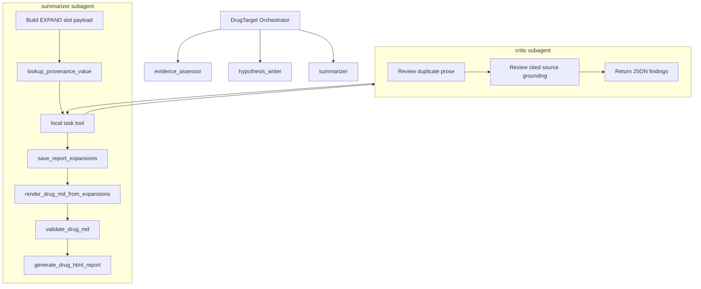
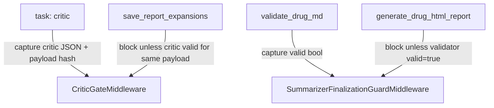

# drug_target Summarizer-Local Critic Subagent Replan

## RALPLAN-DR Summary

### Principles

1. Keep the top-level drug_target workflow stable: orchestrator -> evidence_assessor -> hypothesis_writer -> summarizer.
2. Put prose-review responsibility next to the writer: critic is summarizer-local, not a fourth top-level stage.
3. Separate judgment from enforcement: critic subagent reviews; middleware enforces review-before-save and validate-before-finalize.
4. Avoid heuristic medical vocabulary maintenance unless it proves necessary later.
5. Fail closed on unreviewed or changed payloads while preserving a kill switch for weak-model deployments.
6. Let middleware own machine invariants; never depend on the summarizer LLM or critic LLM to compute payload hashes correctly.
7. Keep deterministic CI independent from LLM-dependent reviewer behavior.

### Decision Drivers

1. Reduce false positives from morphology/synonym/paraphrase mismatches in the original heuristic `critic.py` plan.
2. Preserve PR #19's simplification: no compiled inner graph, no report_writer revival, no Python repair loop.
3. Keep verification mechanical enough that weak summarizer models cannot skip review and still save/finalize.
4. Eliminate duplicate canonical-hash helpers so the critic/save gate cannot fail from serializer drift.

### Viable Options

| Option | Description | Pros | Cons |
| --- | --- | --- | --- |
| A. Heuristic `critic.py` tool | Original approved plan: deterministic tool with medical vocabulary bucket and middleware gate. | Deterministic, cheap, easy to unit test. | Higher false-positive risk, vocabulary rot, morphology/synonym patching, adds a new tool surface. |
| B. Top-level critic stage | Orchestrator calls critic after summarizer output. | Clear pipeline phase, isolated review. | Too late for clean repair, makes critic a fourth global workflow role, orchestrator must reason about report details. |
| C. Summarizer-local critic subagent | Summarizer calls `task(subagent_type="critic")` before save; middleware enforces payload review. | Keeps writer/reviewer boundary, removes heuristic tool, lets critic judge grounding from cited text, keeps top-level workflow stable. | Adds nested subagent middleware and LLM-review nondeterminism; needs strict JSON contract and tests. |

**Favored option:** C.

## Requirements Summary

Replace the proposed heuristic `src/agents/drug_target/tools/critic.py` tool with a simple summarizer-local `critic` subagent. The critic reviews the full EXPAND slot payload before `save_report_expansions`, returns structured JSON findings, and never writes files. A `CriticGateMiddleware` blocks `save_report_expansions` unless the most recent critic result is valid for the exact payload being saved.

## Evidence-Backed Current Architecture

- `src/agents/drug_target/agent.py:3` documents the current three-subagent architecture.
- `src/agents/drug_target/agent.py:71` defines orchestrator steps and calls `summarizer` as step 4.
- `src/agents/drug_target/subagents/configs.py:261` sets `WORKFLOW_ORDER = ["evidence_assessor", "hypothesis_writer", "summarizer"]`.
- `src/agents/drug_target/subagents/configs.py:354` builds the two configured top-level subagents and appends `get_summarizer_subagent()`.
- `src/agents/drug_target/subagents/summarizer/agent.py:44` defines the summarizer dict subagent.
- `src/agents/drug_target/subagents/summarizer/agent.py:66` lists the summarizer's current nine tools.
- `src/agents/drug_target/subagents/summarizer/agent.py:77` installs `SummarizerFinalizationGuardMiddleware`.
- `src/agents/drug_target/subagents/summarizer/middleware.py:136` defines the existing validator-before-finalization guard pattern to mirror.
- Installed DeepAgents `SubAgentMiddleware` requires a backend and explicit subagent specs; declarative subagents must have explicit model and tools.
- Installed DeepAgents `task` returns a `Command` whose `update["messages"]` contains the subagent's `ToolMessage`; critic result capture cannot assume a direct `ToolMessage`.
- `save_report_expansions` accepts `ReportExpansionsPayload`, and `report_expansion_schema.py` already provides `canonical_json_hash`.
- `src/agents/drug_target/subagents/summarizer/middleware.py` currently defines `_canonical_payload_hash`, whose JSON serialization differs from `report_expansion_schema.canonical_json_hash`; this ambiguity must be removed before adding the critic gate.
- Existing `CRITIC_PROMPT` and `validate_drug_report_finalization(require_critic=True)` are legacy post-report surfaces with a different persisted `critic_report.json` schema; the new path is pre-save and in-memory.
- The existing drug_target documentation target is `docs/drugtarget/drug_target_agent_reference.md`, not `docs/drug_target_agent.md`.
- `REPORT_WRITER_PROMPT` is also a dead pre-simplification prompt surface and should be cleaned with the legacy critic prompt work.

## Target Architecture



### Canonical Critic Task Envelope

The summarizer must call the local `task` tool with a machine-parseable JSON
envelope embedded in the task `description`. The envelope is the only payload
source that `CriticGateMiddleware` trusts for hash comparison.

```json
{
  "schema_version": "summarizer_critic_review.v1",
  "payload_hash": "<middleware-computed or prompt-supplied canonical hash>",
  "payload": {
    "schema_version": "report_expansions.v1",
    "reference_card_hash": "...",
    "slots": []
  },
  "provenance_context": {
    "slot_id": {
      "cited_source_values": [],
      "cited_provenance_entries": []
    }
  }
}
```

Implementation detail: middleware computes or verifies `payload_hash` over a
normalized `ReportExpansionsPayload` representation using
`canonical_json_hash` from `report_expansion_schema.py`. Normalization must be
identical for critic-envelope payloads and `save_report_expansions` payloads.
In particular, `reference_card_hash` is optional in the tool schema and may be
auto-derived by `save_report_expansions`; the gate must either fill the same
derived value for both sides or remove that auto-derived-only field from both
hash inputs. The LLM-provided hash is not trusted unless it matches the
middleware-computed normalized hash.

`provenance_context` is intentionally cited-only: for each slot, include only
the `(source_file, source_field)` entries actually cited by that slot's
sentences. Do not include the full `provenance_index`; large gene panels can
otherwise create 30k-50k token critic prompts before the reviewer has done any
work.



## Acceptance Criteria

- Default top-level workflow remains three primary subagents: `evidence_assessor`, `hypothesis_writer`, `summarizer`.
- `critic` is available only inside the summarizer via summarizer-local task delegation, not as a top-level orchestrator step.
- No new `src/agents/drug_target/tools/critic.py` is introduced.
- All payload hashing in `CriticGateMiddleware`, critic-envelope generation, tests, and `HypothesisRetryLoopMiddleware` uses `canonical_json_hash` from `src/agents/drug_target/tools/report_expansion_schema.py`.
- `_canonical_payload_hash` is deleted from `src/agents/drug_target/subagents/summarizer/middleware.py`; `grep -rn '_canonical_payload_hash' src/agents/drug_target/` returns zero matches.
- `get_subagents()` passes the real backend and default/critic model into `get_summarizer_subagent()`; nested `SubAgentMiddleware` setup is not optional.
- Critic model routing is concrete: `DrugTargetConfig.__post_init__` includes `"critic"` in `load_subagent_models_from_env([...])`; `get_subagents()` resolves `critic_model = model_overrides.get("critic") or model_overrides.get("summarizer") or default_model`; `get_summarizer_subagent(..., critic_model=critic_model)` passes that explicit model to `get_critic_subagent()`.
- `DrugTargetConfig.critic_enabled: bool = field(default_factory=_critic_enabled_default_from_env)` is the single kill-switch mechanism. The default factory parses `DRUG_TARGET_CRITIC_ENABLED` fail-closed; an explicit caller-provided bool overrides the env because dataclass default factories run only when the argument is omitted.
- `config.critic_enabled` is threaded explicitly through `create_drug_target_agent(...) -> get_subagents(..., critic_enabled=config.critic_enabled) -> get_summarizer_subagent(..., critic_enabled=critic_enabled)` so the kill switch controls both middleware installation and prompt assembly.
- `save_report_expansions` is blocked until critic returns `valid=true` for the same canonical slot payload.
- `generate_drug_html_report` remains blocked until `validate_drug_md` returns `valid=true`.
- Critic returns parseable JSON containing `valid`, `findings`, `findings_count`, `payload_hash`, and per-finding `finding_type`, `severity`, `slot_ids`, `sentence`, `reason`, `repair_instruction`.
- Critic task descriptions use `schema_version="summarizer_critic_review.v1"` and contain a parseable `payload` object.
- Critic/save payload hashes are computed over the same normalized `ReportExpansionsPayload` representation, including the `reference_card_hash` omitted/auto-derived case.
- Critic envelopes include only cited provenance entries, not full provenance indexes.
- Critic prompt explicitly forbids judging whether a medical claim is generally true; it may only judge whether cited source/provenance text supports the sentence.
- Critic prompt draft exists in Appendix A, is <=2000 tokens, references `schema_version="summarizer_critic_review.v1"`, and includes one passing and one rejecting worked example.
- Existing legacy `CRITIC_PROMPT` is replaced or renamed so `SUBAGENT_PROMPTS["critic"]` does not expose an incompatible old schema.
- `REPORT_WRITER_PROMPT` and any dead `report_writer` prompt exports/references are removed if they are not still used.
- `validate_drug_report_finalization(require_critic=True)` remains a legacy persisted-report compatibility path and is not used by the new pre-save summarizer gate.
- `CriticGateMiddleware` and `SummarizerFinalizationGuardMiddleware` state are reset per summarizer run via `before_agent`, or keyed by active tool-call/thread context so stale critic/validator results cannot leak between runs.
- `CriticGateMiddleware` captures critic output from both direct `ToolMessage` and real DeepAgents `Command.update["messages"]` return paths.
- The save-time gate hashes `request.tool_call["args"]["expansions"]` before `handler(request)` runs; a code comment documents that `save_report_expansions` mutates `reference_card_hash` later during validation.
- Round-trip regression tests cover duplicate prose, ungrounded medical claim, payload mutation after critic pass, critic JSON malformed output, disabled critic mode, and validator-after-critic repair loop.
- `uv run pytest tests/agents/drug_target/ -m "not llm"` passes for deterministic CI and finishes in <60s on a normal development machine.
- `uv run pytest tests/agents/drug_target/ -m llm` passes against the configured critic model before live-smoke evidence is claimed.
- `ruff check src/agents/drug_target/ tests/agents/drug_target/` passes.
- `pyright src/agents/drug_target/` passes.

## Implementation Steps

0. Establish RED-first cadence and deterministic/LLM test split.
   - Register a `llm` pytest marker in `pyproject.toml` if it is not already present.
   - For every implementation step below, write the smallest failing deterministic test first, implement only enough to pass it, then continue.
   - Keep LLM-dependent critic behavior tests behind `@pytest.mark.llm`; deterministic gate/schema tests must run with `-m "not llm"`.

1. Make backend/model propagation explicit.
   - Update `src/agents/drug_target/subagents/configs.py` so `default_model` and `backend` are no longer discarded before summarizer construction.
   - Update `get_subagents()` to accept `critic_enabled: bool` and pass it to `get_summarizer_subagent(...)`.
   - Update `create_drug_target_agent()` to pass `config.critic_enabled` into `get_subagents(..., critic_enabled=config.critic_enabled)`.
   - Update `get_summarizer_subagent()` in `src/agents/drug_target/subagents/summarizer/agent.py` to accept `backend`, `default_model`, `critic_model`, and `critic_enabled`.
   - Update `DrugTargetConfig.__post_init__` in `src/agents/drug_target/agent.py` so `load_subagent_models_from_env([...])` checks `critic` in addition to `evidence_assessor`, `hypothesis_writer`, and `summarizer`.
   - Resolve critic model in `get_subagents()` as `critic_model = model_overrides.get("critic") or model_overrides.get("summarizer") or default_model`. Because `create_drug_target_agent()` normally passes `default_model=llm`, the absence branch is only for direct tests/callers that pass `None`; document that explicitly.
   - Add a setup test that constructing the drug_target subagent specs with critic enabled exposes summarizer-local task capability and that actual `get_subagents(...)` factory output contains only `{"evidence_assessor", "hypothesis_writer", "summarizer"}` at the top level.

2. Add critic subagent spec.
   - Create `src/agents/drug_target/subagents/critic.py` or `src/agents/drug_target/subagents/critic/agent.py`.
   - Define `get_critic_subagent()` returning a DeepAgents subagent dict with `name="critic"`, no write tools, and a strict review prompt.
   - Give the critic explicit `model` and `tools` fields because DeepAgents rejects declarative subagents without them.
   - Recommended first-pass tools: `[]`. If the critic needs context, it must receive it in the task envelope rather than reading files.
   - Prefer `response_format` with a Pydantic schema if compatible with the configured model stack; otherwise use JSON text and enforce parsing in middleware.

3.0. Run a focused nested-SubAgentMiddleware spike before broad implementation.
   - Construct a minimal summarizer-like agent with `SubAgentMiddleware(backend=mock_or_state_backend, subagents=[critic_spec])`.
   - Invoke the installed `task` `StructuredTool` path, not a mocked helper: the dummy summarizer must call `task(subagent_type="critic", description="ping")` through the real middleware-injected tool.
   - Assert the returned object shape exactly enough for the gate extractor: `isinstance(result, Command)`, `result.update["messages"][-1]` is a `ToolMessage`, and `result.update["messages"][-1].content` contains the critic result.
   - Record that observed shape in a test fixture; expected installed shape is `Command(update={"messages": [ToolMessage(...)]})`.
   - If this spike fails, stop and write a follow-up plan; do not introduce a local review tool or heuristic `critic.py` fallback.

3. Install summarizer-local `SubAgentMiddleware`.
   - Update `src/agents/drug_target/subagents/summarizer/agent.py`.
   - Import `SubAgentMiddleware` and `get_critic_subagent()`.
   - Add `SubAgentMiddleware(backend=<inherited or configured backend>, subagents=[get_critic_subagent(...)])` to summarizer middleware before `CriticGateMiddleware`.
   - This is a hard implementation gate: do not proceed to prompt changes until a focused test proves nested task invocation can be constructed.

4.0. Consolidate canonical hash helpers before adding critic hashing.
   - Delete `_canonical_payload_hash` from `src/agents/drug_target/subagents/summarizer/middleware.py`.
   - Update `HypothesisRetryLoopMiddleware` to import and use `canonical_json_hash` from `src/agents/drug_target/tools/report_expansion_schema.py`.
   - Add `test_canonical_payload_hash_deleted_from_middleware` and a grep-based acceptance check for zero `_canonical_payload_hash` matches under `src/agents/drug_target/`.

4. Define and enforce the critic task envelope.
   - Add helper functions in `summarizer/middleware.py` or a small sibling module for parsing the JSON envelope from `task.description`.
   - Envelope fields: `schema_version`, `payload`, `payload_hash`, `provenance_context`.
   - `provenance_context` must include only provenance entries cited by the slot's sentences; do not include full `provenance_index`.
   - Add a shared normalization helper for hash inputs. It must accept raw dict payloads and Pydantic/model-dumped payloads, normalize them into the same canonical shape, and handle omitted `reference_card_hash` consistently with the save tool's auto-derived behavior.
   - Middleware computes the canonical hash from the normalized payload using `canonical_json_hash`; mismatches become fail-closed blocked responses.
   - Do not trust a hash computed by either LLM.

5. Add `CriticGateMiddleware`.
   - Add to `src/agents/drug_target/subagents/summarizer/middleware.py`.
   - Mirror `SummarizerFinalizationGuardMiddleware` structure: capture one tool result, gate a later tool call.
   - Capture `task` calls where `args["subagent_type"] == "critic"`.
   - Parse critic JSON from both possible result shapes:
     - direct `ToolMessage.content` for unit-level simulations;
     - `Command.update["messages"][-1].content` for real `SubAgentMiddleware.task` calls.
   - Store `critic_called`, `last_valid`, `last_findings`, and `last_payload_hash`.
   - Gate `save_report_expansions`; block no-call, invalid/malformed critic result, blocker findings, and payload hash mismatch.
   - Hash `request.tool_call["args"]["expansions"]` before calling `handler(request)`; add an inline comment that `save_report_expansions` mutates `reference_card_hash` during validation and the gate intentionally compares the LLM-submitted pre-handler payload.
   - Include unresolved findings and hash diff in the ToolMessage so summarizer can repair.
   - Add `before_agent` reset logic, or key state by thread/run context if available.

5.1. Fix existing finalization guard state leak in the same pass.
   - Add equivalent `before_agent` reset/keyed-state behavior to `SummarizerFinalizationGuardMiddleware`.
   - Add `test_summarizer_finalization_guard_resets_between_runs`; do not leave the older validator gate with a known state leak while adding the new critic gate.

6. Replace or retire legacy critic prompt surfaces.
   - Update `src/agents/drug_target/subagents/prompts.py`.
   - Replace old `CRITIC_PROMPT` with the new pre-save critic reviewer prompt, or rename the legacy prompt so `SUBAGENT_PROMPTS["critic"]` cannot accidentally point to the old schema.
   - Add the Appendix A prompt draft below as the starting implementation text, keeping it <=2000 tokens.
   - Remove `REPORT_WRITER_PROMPT` and its export from `__all__` if no live code references it; remove any remaining `SUBAGENT_PROMPTS["report_writer"]` mapping if present.
   - Update the summarizer prompt line that currently says there are no inner subagents.
   - Keep `validate_drug_report_finalization(require_critic=True)` behavior unchanged as a legacy persisted `evidence/critic_report.json` path; document that the new summarizer critic gate does not write or require that file.

7. Update summarizer prompt.
   - Edit `SUMMARIZER_PROMPT` in `src/agents/drug_target/subagents/prompts.py`.
   - Split the prompt into `SUMMARIZER_PROMPT_CORE` plus optional `CRITIC_REVIEW_STEP_FRAGMENT`.
   - Assemble the final prompt at construction time in `get_summarizer_subagent(critic_enabled=...)`.
   - When `critic_enabled=False`, the assembled prompt must contain no `task(subagent_type="critic"` or `critic_review` instruction.
   - When enabled, insert a numbered critic-review step between EXPAND payload construction/provenance lookup and `save_report_expansions`.
   - Tell summarizer to call `task(subagent_type="critic", description=<full payload + cited provenance + exact JSON contract>)`.
   - Require full payload rebuild, not patch-only edits, after any blocker finding.
   - Limit critic repair attempts to 2 before `SUMMARIZER_STATUS: FAIL`.

8. Add config and kill switch.
   - Add `_critic_enabled_default_from_env() -> bool` near `DrugTargetConfig`.
   - Add `DrugTargetConfig.critic_enabled: bool = field(default_factory=_critic_enabled_default_from_env)`.
   - Do not re-interpret `critic_enabled` in `__post_init__`; explicit constructor values must win over `DRUG_TARGET_CRITIC_ENABLED`.
   - Parser should fail closed: only `false`, `0`, `no`, `off` disable critic; typo or unknown values keep critic enabled.
   - Optionally log a warning for unknown non-empty env values that keep critic enabled; do not weaken fail-closed behavior.
   - When disabled, omit the critic subagent middleware and `CriticGateMiddleware`, and render prompt guidance as disabled/no-op.

9. Add per-step RED tests and LLM-gated contract tests.
   - Each implementation step above carries its RED test before code changes.
   - Add LLM-gated tests for actual critic prompt behavior under `@pytest.mark.llm`.
   - Keep deterministic tests for schema, envelope parsing, hash behavior, disabled mode, middleware state reset, and factory wiring under `-m "not llm"`.
   - Add round-trip tests proving the original Issue #20 examples are rejected before save.

10. Update docs.
   - Update `docs/drugtarget/drug_target_agent_reference.md` with the nested reviewer architecture.
   - Update `docs/wiki/20_Lessons/drug-target-fail-closed-gates.md` with the decision to replace heuristic `critic.py` with summarizer-local critic subagent.
   - Mention that critic is a reviewer, not an author, and that middleware is the enforcement layer.

## Test Plan

### Unit / Contract Tests

- `test_critic_subagent_prompt_forbids_medical_truth_judgment`
- `test_critic_subagent_schema_requires_valid_findings_payload_hash`
- `test_summarizer_factory_passes_backend_and_model_to_local_critic`
- `test_get_subagents_factory_output_does_not_include_top_level_critic`
- `test_nested_subagent_middleware_spike_returns_command_update_messages`
- `test_critic_task_envelope_requires_schema_version_payload_and_hash`
- `test_critic_task_envelope_rejects_llm_hash_mismatch`
- `test_critic_envelope_excludes_uncited_provenance_entries`
- `test_critic_save_hash_matches_when_reference_card_hash_omitted_then_auto_derived`
- `test_critic_save_hash_matches_for_raw_dict_and_pydantic_payload_shapes`
- `test_canonical_payload_hash_deleted_from_middleware`
- `test_hypothesis_retry_loop_uses_report_expansion_canonical_json_hash`
- `test_critic_gate_blocks_save_when_critic_never_called`
- `test_critic_gate_blocks_save_when_critic_json_malformed`
- `test_critic_gate_blocks_save_when_critic_valid_false`
- `test_critic_gate_blocks_save_when_payload_hash_mismatch`
- `test_critic_gate_allows_save_after_valid_matching_payload`
- `test_critic_gate_captures_real_task_command_update_messages`
- `test_critic_gate_resets_between_summarizer_runs`
- `test_summarizer_finalization_guard_resets_between_runs`
- `test_critic_gate_hashes_pre_validation_payload`
- `test_critic_disabled_env_omits_local_subagent_gate`
- `test_critic_enabled_default_factory_respects_env_false`
- `test_critic_enabled_default_factory_unknown_env_stays_enabled`
- `test_critic_enabled_explicit_true_overrides_env_false`
- `test_critic_enabled_explicit_false_overrides_env_true`
- `test_create_drug_target_agent_threads_critic_enabled_to_subagents`
- `test_get_subagents_threads_critic_enabled_to_summarizer_factory`
- `test_summarizer_prompt_disabled_mode_contains_no_critic_task_instruction`
- `test_summarizer_prompt_enabled_mode_contains_critic_fragment`
- `test_subagent_prompts_critic_schema_is_not_legacy_claim_verdict_schema`
- `test_report_writer_prompt_dead_code_removed`
- `test_validate_drug_report_finalization_require_critic_remains_legacy_path`

### LLM-Gated Tests

Mark these with `@pytest.mark.llm` and exclude from deterministic CI:

- `test_critic_subagent_rejects_plausible_but_ungrounded_medical_claim`
- `test_critic_subagent_passes_source_grounded_medical_sentence`
- `test_critic_subagent_returns_json_only_for_appendix_a_examples`

### Integration / Round-Trip Tests

- Duplicate boilerplate payload is rejected before `save_report_expansions`.
- Ungrounded external medical claim is rejected before `save_report_expansions`.
- Source-grounded medical wording passes critic and proceeds to validator.
- Payload changed after critic approval is blocked.
- Validator failure after critic pass routes back to payload repair and then critic re-review.

### Verification Commands

```bash
uv run pytest tests/agents/drug_target/test_summarizer_dict_spec.py -v
uv run pytest tests/agents/drug_target/test_critic_gate_middleware.py -v
uv run pytest tests/agents/drug_target/test_summarizer_round_trip.py -v
uv run pytest tests/agents/drug_target/ -m "not llm" -v
uv run pytest tests/agents/drug_target/ -m llm -v
grep -rn '_canonical_payload_hash' src/agents/drug_target/ || true
ruff check src/agents/drug_target/ tests/agents/drug_target/
pyright src/agents/drug_target/
```

## Risks and Mitigations

| Risk | Impact | Mitigation |
| --- | --- | --- |
| Nested `SubAgentMiddleware` cannot be cleanly installed in a subagent with current factory signatures. | High | First implementation task proves `get_summarizer_subagent(backend, model)` wiring. If blocked, stop and write a follow-up plan; do not introduce a local review tool as an unplanned fallback. |
| `task.description` is free text, making exact payload comparison fragile. | High | Require a JSON envelope and have middleware parse/verify it before accepting critic results. |
| Duplicate hash helpers diverge and create false hash mismatches. | High | Delete middleware-local `_canonical_payload_hash`; switch `HypothesisRetryLoopMiddleware` and critic gate to `canonical_json_hash`; grep for zero old-helper matches. |
| `reference_card_hash` omitted/auto-derived behavior causes critic/save hash mismatch. | High | Hash only the normalized representation shared by critic envelope and save payload; lock omitted and explicit cases with tests. |
| `task` returns `Command` rather than direct `ToolMessage`, so critic capture can silently fail. | High | Add result extraction helper for direct `ToolMessage` and `Command.update["messages"]`; lock with a real-shape unit test. |
| Existing finalization guard leaks validator state across reused agent runs. | High | Add the same reset/keyed-state fix to `SummarizerFinalizationGuardMiddleware`; lock with a regression test. |
| Critic envelope grows beyond context limits on larger panels. | Medium | Keep `provenance_context` cited-only; add a token-size risk note and fixture asserting uncited entries are excluded. |
| Critic subagent accepts generally true but ungrounded medical knowledge. | High | Prompt: judge only cited-source support, not truth; tests with plausible-but-ungrounded claims. |
| Critic JSON is malformed. | Medium | Gate treats malformed output as invalid and returns repairable ToolMessage. |
| LLM critic is nondeterministic. | Medium | Keep output schema narrow; use regression fixtures; consider model override for critic if needed. |
| Summarizer calls critic but saves a modified payload. | High | Payload hash gate blocks mismatch. |
| More nested agent complexity reverses the simplification work. | Medium | No report_writer revival, no compiled graph, no Python repair loop; critic has one role and no write tools. |
| Legacy critic prompt/schema conflicts with new pre-save critic. | Medium | Replace/rename legacy prompt mapping and document `validate_drug_report_finalization(require_critic=True)` as compatibility-only. |

## ADR

### Decision

Use a summarizer-local `critic` subagent plus `CriticGateMiddleware` instead of adding a heuristic `critic.py` tool.

### Drivers

- Reduce heuristic false positives while preserving fail-closed save enforcement.
- Keep the top-level drug_target workflow stable.
- Preserve writer/reviewer/enforcer separation.

### Alternatives Considered

- Heuristic `critic.py` tool: rejected because the vocabulary and morphology logic becomes a maintenance burden and may over-block valid prose.
- Top-level critic stage: rejected because review happens too late and makes orchestrator responsible for summarizer-specific repair.
- Post-render validator extension only: rejected because it does not provide a clean repair loop before `save_report_expansions`.

### Why Chosen

The summarizer-local critic subagent matches the task boundary: summarizer writes and repairs prose, critic reviews that prose, and middleware prevents bypass. This avoids heuristic medical terminology churn without making critic a global pipeline phase.

### Consequences

- Adds one nested subagent dependency to summarizer.
- Adds one gate middleware.
- Removes the need for `critic.py`, medical vocabulary buckets, synonym maps, and morphology xfail cases.
- Requires stronger JSON contract tests because review is LLM-mediated.
- Requires factory signature changes so summarizer can receive backend/model for nested subagent middleware.
- Requires adding `critic` to the subagent model env loading contract (`SUBAGENT_CRITIC_PROVIDER`, `SUBAGENT_CRITIC_MODEL`, etc.).
- Requires deleting the old middleware-local hash helper and touching `HypothesisRetryLoopMiddleware` even though that middleware is not part of the critic feature.
- Requires prompt assembly rather than a single `SUMMARIZER_PROMPT` constant so disabled mode does not instruct nonexistent critic calls.
- Leaves `validate_drug_report_finalization(require_critic=True)` as a legacy persisted-report path, not part of the new pre-save gate.

### Follow-ups

- If critic nondeterminism is high, add a dedicated critic model override.
- If duplicate prose still slips through, add a tiny deterministic duplicate sanity check inside middleware or renderer tests.
- If source grounding remains subjective, consider a later LLM-as-judge rubric comparison against cited snippets only.
- If future finalization flows need a persisted critic artifact, add a separate `critic_report.json` persistence plan rather than mixing it into the pre-save gate.
- If deleting `REPORT_WRITER_PROMPT` reveals hidden imports, stop and either restore it or document a smaller compatibility cleanup; do not broaden the feature PR into an unrelated prompt refactor.

## Available-Agent-Types Roster

- `explore`: repo-local file/symbol/pattern mapping.
- `architect`: architecture review and tradeoff analysis.
- `critic`: plan review and acceptance-gate evaluation.
- `executor`: implementation/refactoring.
- `test-engineer`: test design and coverage.
- `verifier`: completion evidence and test adequacy.
- `writer`: docs and migration notes.
- `code-reviewer`: post-implementation review.

## Follow-up Staffing Guidance

### `$ralph` Path

Use one persistent owner for implementation and verification.

- `executor` lane, reasoning medium/high: implement critic subagent wiring and middleware.
- `test-engineer` lane, reasoning medium: can be consulted for test shape if failures are subtle.
- `verifier` lane, reasoning high: final validation before completion.

### `$team` Path

Use parallel lanes because tests, middleware, prompt/subagent wiring, and docs are separable.

- Lane 1 `test-engineer`: write RED tests for critic gate and summarizer inventory.
- Lane 2 `executor`: run Step 3.0 nested `SubAgentMiddleware` spike and implement critic subagent spec/wiring only after the spike passes.
- Lane 3 `executor`: consolidate hash helpers, implement `CriticGateMiddleware`, and add reset behavior to both summarizer gates.
- Lane 4 `writer`: update `docs/drugtarget/drug_target_agent_reference.md`, wiki, and prompt appendix references after implementation stabilizes.
- Lane 5 `verifier`: run deterministic/LLM split verification, check payload-hash invariants, and confirm disabled-mode prompt assembly.

Suggested reasoning: high for middleware/verifier, medium for tests/docs, high for architecture conflict resolution.

### Launch Hints

```bash
$ralph "Execute .omx/plans/drug-target-critic-subagent-replan.md"
```

```bash
$team "Implement .omx/plans/drug-target-critic-subagent-replan.md with lanes: tests, critic subagent wiring, CriticGateMiddleware, docs, verification"
```

## Team Verification Path

Team proves:

- RED tests fail before implementation and pass after implementation.
- Nested `SubAgentMiddleware` spike proves the actual `Command.update["messages"]` shape.
- `_canonical_payload_hash` is gone and all relevant middleware uses `canonical_json_hash`.
- `CriticGateMiddleware` blocks no-call, invalid critic, hash mismatch, and malformed JSON.
- `save_report_expansions` cannot be reached with an unreviewed payload.
- `validate_drug_md` still gates HTML generation.
- `SummarizerFinalizationGuardMiddleware` and `CriticGateMiddleware` reset state between reused runs.

Ralph/verifier proves after handoff:

- Deterministic `tests/agents/drug_target/ -m "not llm"` suite is green.
- LLM-gated `tests/agents/drug_target/ -m llm` suite is green or explicitly documented with model/config blocker.
- `ruff` and `pyright` are clean.
- Docs reflect actual tool/subagent inventory.
- No `src/agents/drug_target/tools/critic.py` exists unless explicitly reintroduced by a later approved plan.

## Goal-Mode Follow-up Suggestions

- `$ultragoal`: default if this plan should become a durable goal with tracked implementation and verification.
- `$performance-goal`: not a fit unless later work focuses on latency/cost of nested critic calls.
- `$autoresearch-goal`: not a fit; this is implementation architecture, not literature/research validation.

## Appendix A — Critic Prompt Draft

Use this as the starting `CRITIC_PROMPT` replacement. Keep the implementation
prompt <=2000 tokens and preserve the exact JSON field names.

```text
You are the read-only critic for the drug_target summarizer.
You review a pre-save EXPAND payload. You never write files.

Input is JSON with schema_version="summarizer_critic_review.v1",
payload_hash, payload, and cited-only provenance_context.

Judge only whether each sentence is supported by its cited source/provenance
text. Do not judge whether a medical claim is generally true. If a sentence
is plausible but not supported by the cited text, mark it blocker.

Also flag boilerplate: the same substantive sentence reused across multiple
slot_ids without slot-specific wording.

Return JSON only:
{
  "valid": boolean,
  "payload_hash": string,
  "findings_count": number,
  "findings": [
    {
      "finding_type": "BOILERPLATE_DUPLICATE|EXTERNAL_KNOWLEDGE_INJECT",
      "severity": "blocker|warning",
      "slot_ids": ["..."],
      "sentence": "...",
      "reason": "...",
      "repair_instruction": "..."
    }
  ]
}

valid=false if any blocker finding exists. Warnings do not block save.
```

Worked example, pass:

```json
{
  "valid": true,
  "payload_hash": "sha256:example-pass",
  "findings_count": 0,
  "findings": []
}
```

Worked example, reject:

```json
{
  "valid": false,
  "payload_hash": "sha256:example-reject",
  "findings_count": 1,
  "findings": [
    {
      "finding_type": "EXTERNAL_KNOWLEDGE_INJECT",
      "severity": "blocker",
      "slot_ids": ["section_3_mmp7"],
      "sentence": "MMP7 modulates TGF-beta signaling and fibrotic remodeling.",
      "reason": "The cited source lists drug evidence but does not support TGF-beta or fibrotic-remodeling claims.",
      "repair_instruction": "Remove the unsupported mechanism or cite a source_value that actually contains it."
    }
  ]
}
```

## Changelog

- Draft created from discussion replacing heuristic `critic.py` with summarizer-local critic subagent.
- Architect review applied: backend/model propagation, canonical task envelope, legacy critic prompt cleanup, legacy `critic_report.json` boundary, middleware state reset.
- Critic rejection applied: parse real DeepAgents `Command.update["messages"]` result shape, use existing docs path, remove local-tool fallback, make critic model routing concrete.
- Architect second pass applied: normalized `ReportExpansionsPayload` hash rule for omitted/auto-derived `reference_card_hash`.
- Critic second pass returned OKAY; plan promoted to approved.
- Claude Code review absorbed: P0 hash-helper collision, P1 nested spike, dual-gate reset, cited-only envelope, prompt appendix, disabled prompt assembly, pre-handler hash invariant, RED/LLM test split, and adjacent prompt cleanup.
- Architect follow-up tightening applied: Step 3.0 now requires the real installed `task` `StructuredTool` path, and Appendix A examples are full schema-valid critic outputs.
- Critic follow-up rejection resolved: `critic_enabled` now uses a dataclass `default_factory` env parser so env defaults and explicit caller overrides are unambiguous.
- Architect follow-up applied: `critic_enabled` propagation is explicit from `create_drug_target_agent()` through `get_subagents()` into `get_summarizer_subagent()`.
- Final Critic review after Claude absorption returned OKAY; no executor-blocking contradictions remain.
