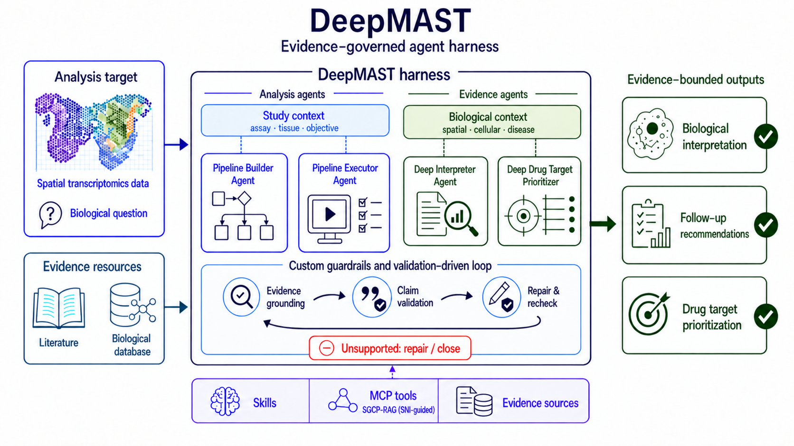
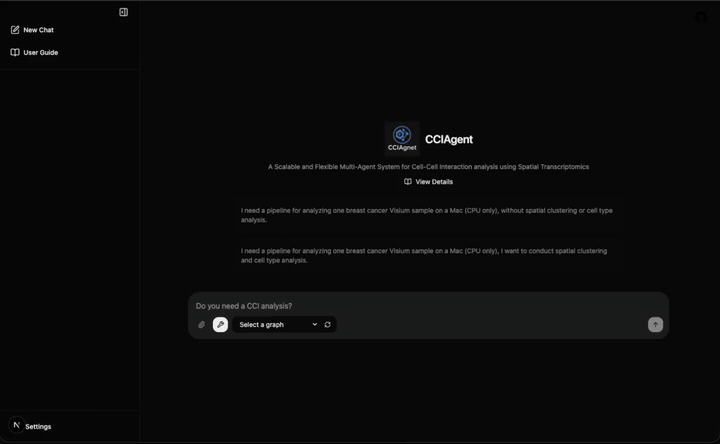
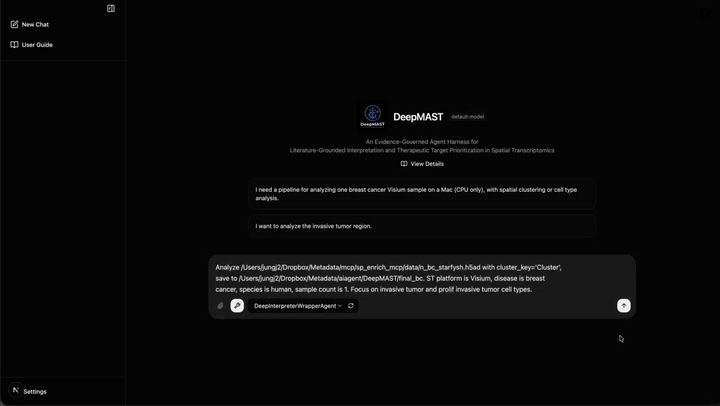
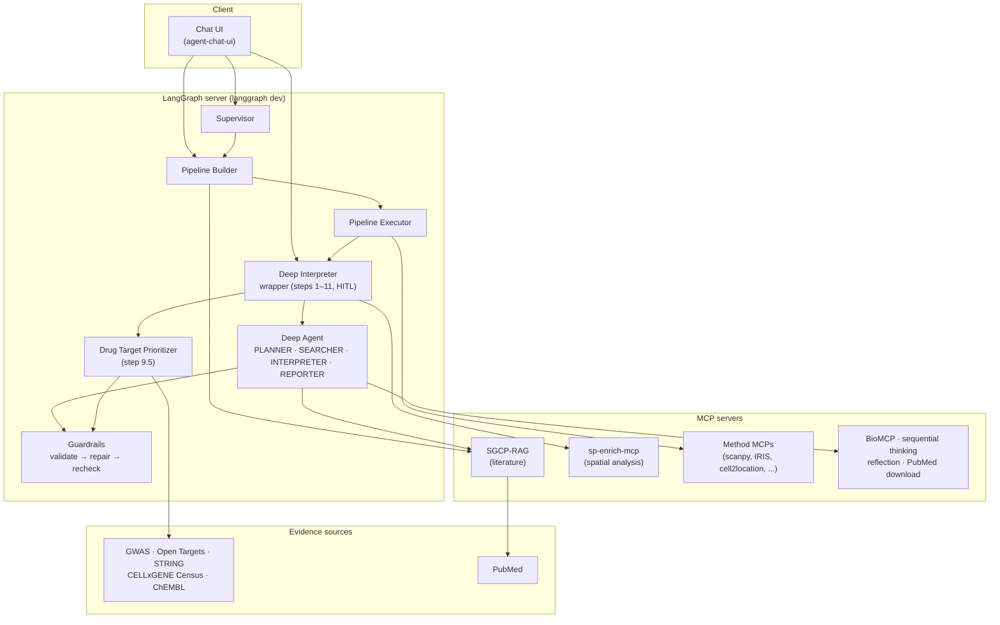

# DeepMAST

> **DeepMAST: an evidence-governed agent harness for spatial transcriptomics — from pipeline design to biological interpretation and drug target prioritization.**

`DeepMAST` is a multi-agent system built on [LangGraph](https://github.com/langchain-ai/langgraph) and [Deep Agents](https://github.com/langchain-ai/deepagents) for spatial transcriptomics (ST) analysis. Starting from an ST dataset and a biological question, its agents design an analysis pipeline, run it, interpret the cell–cell interaction (CCI) results against the literature, and prioritize candidate drug targets. Every claim in the final report must be grounded in an evidence source (analysis output, literature, or a biological database); claims that fail validation are repaired and rechecked, or closed as unsupported.



---

## Table of Contents

1. [Overview — What DeepMAST does](#1-overview--what-deepmast-does)
2. [The agents](#2-the-agents)
   - [2.1 Pipeline Builder](#21-pipeline-builder)
   - [2.2 Pipeline Executor](#22-pipeline-executor)
   - [2.3 Deep Interpreter](#23-deep-interpreter)
   - [2.4 Drug Target Prioritizer](#24-drug-target-prioritizer)
   - [2.5 Supervisor](#25-supervisor)
3. [The evidence-governed harness](#3-the-evidence-governed-harness)
4. [Architecture](#4-architecture)
5. [Quick Start](#5-quick-start)
6. [Usage in Detail](#6-usage-in-detail)
7. [External MCP servers](#7-external-mcp-servers)
8. [Environment variables](#8-environment-variables)
9. [Testing](#9-testing)
10. [Repository layout](#10-repository-layout)

---

## 1. Overview — What DeepMAST does

DeepMAST splits ST analysis into two groups of agents that share one harness:

| Group | Agent | What it does |
|-------|-------|--------------|
| **Analysis agents** | **Pipeline Builder** | Collects the study context (technology, tissue, species, compute) through conversation and recommends an analysis pipeline (normalization → cell-type analysis → spatial clustering); on request it cites the method papers behind each choice. |
| | **Pipeline Executor** | Runs the selected pipeline on the user's `.h5ad` data, calling one MCP server per analysis method. |
| **Evidence agents** | **Deep Interpreter** | Runs the spatial CCI analysis (steps 1–11: clustering, pathway enrichment, MISTy, LIANA+, NMF factors), searches the literature, and writes an evidence-grounded HTML report. |
| | **Drug Target Prioritizer** | Scores the top ligand–receptor pairs with GWAS, Open Targets, STRING, CELLxGENE Census, and ChEMBL evidence and writes guarded follow-up recommendations. |
| **Orchestration** | **Supervisor** | Routes a request through Pipeline Builder → Pipeline Executor → Deep Interpreter. |

The harness around them provides:

- **Custom guardrails and a validation-driven loop** — evidence grounding → claim validation → repair & recheck, with unsupported claims repaired or closed (see [§3](#3-the-evidence-governed-harness)).
- **Skills** — on-demand workflow documents in [`skills/`](skills/) that agents load only when a task needs them.
- **MCP tools** — analysis, literature, and database servers, including [SGCP-RAG](https://github.com/junghyunJJ/sgcp-rag) (SNI-guided literature retrieval).

All agents are served by one LangGraph server (`langgraph dev`) and are used through a chat UI.

---

## 2. The agents

### 2.1 Pipeline Builder

Graph: `Pipeline_builder` · Source: [`src/agents/pipeline/st_pipeline_info_agent.py`](src/agents/pipeline/st_pipeline_info_agent.py)

The Pipeline Builder asks for the missing study context (ST technology, disease, species, sample count, OS, GPU, and which analyses are needed), proposes a default pipeline, and lets the user choose through a human-in-the-loop (HITL) step: accept the default, customize individual steps, or ask for **reference-based recommendations**. In the reference-based option it searches the method-paper collection in SGCP-RAG and explains why each tool fits the data and hardware, with the source papers listed.

Graph nodes: `check_state` → `info_collection` → `info_validation` → `pipeline_generation` → `human_decision` → `check_human_decision` → `pipeline_update` / `pipeline_selection` → `pipeline_summary`.

**Demo** — a breast cancer Visium sample on a CPU-only Mac (1 min 46 s, sped up 5× in the preview):

[](assets/videos/pipeline_builder_demo.mp4)

<sub>Click the preview to open the full video ([`pipeline_builder_demo.mp4`](assets/videos/pipeline_builder_demo.mp4)).</sub>

### 2.2 Pipeline Executor

Graph: `Pipeline_executor` · Source: [`src/agents/executor/executor_agent.py`](src/agents/executor/executor_agent.py)

The Executor runs a pipeline produced by the Pipeline Builder in two phases:

1. **Preparation** — load the pipeline config, collect the `.h5ad` data (asks again if missing), resolve a single-cell reference for spot-based data, validate the data, and look up an MCP server for every step in the registry. For a method with no registry entry, an LLM generates an MCP server file (`generate_mcp`).
2. **Execution** — after a human confirmation step, a single ReAct agent calls the method-specific MCP tools and saves the results.

Method → MCP server mapping lives in [`src/agents/executor/mcp_registry.py`](src/agents/executor/mcp_registry.py) (see [§7](#7-external-mcp-servers)).

### 2.3 Deep Interpreter

Graph: `Interpreter` · Source: [`src/agents/deep_interpreter/`](src/agents/deep_interpreter/)

The Deep Interpreter has two layers:

- **Wrapper agent** ([`wrapper_agent.py`](src/agents/deep_interpreter/wrapper_agent.py)) — collects the inputs, runs the spatial analysis through the `sp-enrich-mcp` server one step at a time, asks the user to choose clusters / cell types and an NMF factor, runs the drug target assessment, and confirms before starting the interpretation.
- **Deep Agent** ([`agent.py`](src/agents/deep_interpreter/agent.py)) — a `create_deep_agent()` orchestrator with four subagents:

| Subagent | Role |
|----------|------|
| `PLANNER` | Confirms targets, assesses the available data, and writes the interpretation guide. |
| `SEARCHER` | Extracts context, searches PubMed / BioMCP, and writes the literature handoff (`papers.json`). |
| `INTERPRETER` | Writes the Part 1/2/3 interpretations with inline claim validation, using SGCP-RAG full-text search. |
| `REPORTER` | Writes the cross-part synthesis (`synthesis.md`); the HTML report is rendered from the validated outputs. |

Literature is searched **before** interpretation, every PMID citation is checked, and findings without literature support are tagged as novel rather than presented as established.

**Demo** — analysis steps, HITL cluster/factor selection, drug target assessment, and spatial L–R plots (1 min, sped up 3× in the preview):

[](assets/videos/deep_interpreter_demo.mp4)

<sub>Click the preview to open the full video ([`deep_interpreter_demo.mp4`](assets/videos/deep_interpreter_demo.mp4)).</sub>

### 2.4 Drug Target Prioritizer

Graph: `DrugTarget` · Source: [`src/agents/drug_target/`](src/agents/drug_target/)

Runs as analysis step 9.5 inside the Deep Interpreter (or on its own). Input is `lr_candidates.json` (top-30 ligand–receptor pairs) plus the disease context; output is `drug.md`, which is merged into the HTML report. Production is a guarded three-subagent workflow:

1. **`EVIDENCE_ASSESSOR`** — a three-stage evidence funnel: Stage 2 validation and scoring → Stage 1 biological context → Stage 3 ChEMBL drug profiles.
2. **`HYPOTHESIS_WRITER`** — saves the validated evidence handoff.
3. **`REPORT_WRITER`** — renders the report from that handoff; `DrugReportGuardrailMiddleware` validates, repairs, publishes, and audits it, and refuses to publish (fail-closed) when validation still fails.

The output contract is [`docs/drugtarget/output_schema.json`](docs/drugtarget/output_schema.json).

### 2.5 Supervisor

Graph: `Supervisor` · Source: [`src/agents/supervisor/`](src/agents/supervisor/)

A router that invokes Pipeline Builder → Pipeline Executor → Deep Interpreter as subgraphs and ends with a workflow summary. Before each phase it asks for approval (`approve_pipeline`, `approve_executor`, `approve_interpreter`), and a phase can be skipped. Use it for an end-to-end run, or open each agent's graph directly.

---

## 3. The evidence-governed harness

### 3.1 The problem

An LLM asked to interpret CCI results will write fluent text that mixes analysis results, prior knowledge, and invention. In a report that a lab will act on, an unsupported mechanism or a fabricated citation reads exactly like a supported one.

### 3.2 Guardrails and the validation-driven loop

DeepMAST treats the report as a set of claims that must each point to evidence:

```
evidence grounding ──► claim validation ──► repair & recheck ──┐
        ▲                                                      │
        └──────────────────────────────────────────────────────┘
                 still unsupported after the bounded passes → closed
```

| Guardrail | Where | What it checks |
|-----------|-------|----------------|
| Report validation | [`scripts/validate_report.py`](scripts/validate_report.py), [`report_guardrails.py`](src/agents/deep_interpreter/report_guardrails.py) | Cited PMIDs exist in the retrieved paper set (`papers.json`); L–R metric and pathway–factor claims match the analysis outputs; mechanistic interpretations are backed; Part 3 has no therapeutic spillover and covers the selected L–R pairs. |
| Targeted repair | [`scripts/repair_report.py`](scripts/repair_report.py) | Rewrites only the sections the validator flagged, then re-validates (at most 3 repair passes in the guardrail loop). |
| Claim-level RAG validation | [`claim_rag_validation.py`](src/agents/deep_interpreter/claim_rag_validation.py) | High-risk and external-evidence claims are checked against retrieved literature by an LLM judge. |
| Synthesis consistency | [`synthesis_consistency_validation.py`](src/agents/deep_interpreter/synthesis_consistency_validation.py) | Ranked candidates, L–R pairs, and numbers in the synthesis match the source analysis outputs. |
| Overclaim checks | [`report_guardrails.py`](src/agents/deep_interpreter/report_guardrails.py) | Unhedged therapeutic claims and contradictions are flagged for repair. |
| Think-tool quality gate | [`middleware/think_tool_quality_gate.py`](src/agents/deep_interpreter/middleware/think_tool_quality_gate.py) (wired into the Drug Target agent) | Reflection steps must reach a minimum score and stay grounded. |
| Reporter recovery | [`reporter_recovery.py`](src/agents/deep_interpreter/reporter_recovery.py) | Detects incomplete reporter output and retries within a time budget. |
| Drug report guardrail | [`drug_target/report_guardrails.py`](src/agents/drug_target/report_guardrails.py) | Bounded validation and repair of `drug.md`, publishing only when it passes (fail-closed). |

### 3.3 Skills

Skills are folders with a `SKILL.md` that an agent reads only when its task needs it, keeping long procedures out of the always-loaded prompt. A skill activator selects the relevant skills per subagent.

| Skill | Used for |
|-------|----------|
| `biomedical-literature-search`, `pubmed-eutils-search` | PubMed search workflow for L–R claims |
| `html-report-generator` | Report structure, theme, and citation format |
| `gwas-database`, `opentargets-database`, `string-database`, `chembl-database` | Drug target evidence |
| `cellxgene-census`, `compare-census-gene-pair-by-cell-type` | Cell-type expression context from CELLxGENE Census |
| `drug-target-hypothesis`, `drug-target-reporting` | Evidence-backed recommendations and guarded report sections |
| `skill-activator`, `skill-activation-governor` | Choosing which skills each agent loads |

### 3.4 MCP tools

Analysis methods, literature retrieval, and biological databases are reached through MCP servers rather than hard-coded clients, so a method can be swapped by changing a server. The full list is in [§7](#7-external-mcp-servers).

---

## 4. Architecture



Graphs registered in [`langgraph.json`](langgraph.json):

| Graph ID | Entry point |
|----------|-------------|
| `Supervisor` | `src.agents.supervisor.graph_builder:supervisor_graph` |
| `Pipeline_builder` | `src.agents.graph_builders:graph` |
| `Pipeline_executor` | `src.agents.graph_builders:executor_graph` |
| `Interpreter` | `src.agents.deep_interpreter.graph_builder:deep_interpreter_wrapped_graph` |
| `Sub_Planner`, `Sub_Searcher`, `Sub_Interpreter`, `Sub_Reporter` | Deep Interpreter subagents, for debugging one subagent at a time |
| `DrugTarget` | `src.agents.drug_target.graph_builder:drug_target_graph` |
| `DeepMAST_RAG` | `src.agents.graph_builders:pubmed_rag_graph` — PubMed question answering over SGCP-RAG |

---

## 5. Quick Start

### 5.1 Prerequisites

- Python 3.12 and [uv](https://docs.astral.sh/uv/)
- Docker (for the BioMCP and sequential-thinking servers used by the Deep Interpreter and Drug Target agents)
- Node.js with `npx` (Pipeline Builder's reference-based option and `DeepMAST_RAG` start the sequential-thinking server with `npx`)
- An LLM: an API key (OpenAI, Anthropic, Google, OpenRouter) or a local Ollama / vLLM server
- The external MCP servers your workflow needs ([§7](#7-external-mcp-servers)); `sp-enrich-mcp` is required for the Deep Interpreter analysis steps

### 5.2 Install

```bash
git clone https://github.com/junghyunJJ/DeepMAST.git
cd DeepMAST
uv sync
```

### 5.3 Configure `.env`

```bash
cp .env.example .env
```

At minimum set:

- `LLM_PROVIDER` and the matching API key or local server URL
- `DEEP_INTERPRETER_DATA_DIR` — the run directory for analysis outputs and reports
- `SP_ENRICH_MCP_PYTHON`, `SP_ENRICH_MCP_SERVER_PATH` — the spatial analysis MCP server
- `CCI_RAG_PYTHON`, `CCI_RAG_SERVER`, `CCI_RAG_BASE_URL` — SGCP-RAG; required for Pipeline Builder's reference-based option and `DeepMAST_RAG`. Without them the Deep Interpreter falls back to abstract-only literature search.

See [§8](#8-environment-variables) for the rest.

### 5.4 Start the Docker MCP servers

```bash
docker compose -f src/mcpservers/docker/docker-compose.yml up -d
# BioMCP → http://localhost:8000/mcp, sequential thinking → http://localhost:8001
```

### 5.5 Run the LangGraph server

```bash
uv run langgraph dev
# API: http://127.0.0.1:2024  ·  LangGraph Studio opens in the browser
```

### 5.6 Connect the chat UI

The demos use a fork of LangChain's [agent-chat-ui](https://github.com/langchain-ai/agent-chat-ui) ([teddylee777/agent-chat-ui](https://github.com/teddylee777/agent-chat-ui)). Run it next to the LangGraph server and enter:

- **Deployment URL:** `http://localhost:2024`
- **Assistant / Graph ID:** a graph ID from the table in [§4](#4-architecture), e.g. `Pipeline_builder` or `Interpreter`

LangGraph Studio (opened by `langgraph dev`) also works for single-graph runs.

---

## 6. Usage in Detail

### 6.1 Building a pipeline

Open `Pipeline_builder` and describe the study in one message, for example:

> I need a pipeline for analyzing one breast cancer Visium sample on a Mac (CPU only); I want to conduct spatial clustering and cell type analysis.

The agent asks only for what is missing, proposes a default pipeline, and waits for your choice: accept the default, customize a step, or request reference-based recommendations. The reference-based option (option 3 in the demo) searches SGCP-RAG and lists the papers behind each recommended tool.

### 6.2 Running the Deep Interpreter

Open `Interpreter`. The wrapper collects:

| Input | Example |
|-------|---------|
| `.h5ad` file(s) | processed ST data with cluster labels |
| `cluster_key` (required) | `Cluster` |
| `celltype_key` | `.obs` cell-type column; required for single-cell-resolution platforms (MERFISH, Xenium, CosMx, seqFISH, STARmap) |
| `sample_key` | `.obs` sample column; required when there is more than one sample |
| `data_directory` (required) | where steps 1–11 write figures and tables |
| ST technology, disease, species (`human` / `mouse`) | `Visium`, `breast cancer`, `human` — optional; pre-filled when launched from the Supervisor |
| cell types / clusters of interest | `["Invasive Tumor", "Prolif Invasive Tumor"]` |

It then runs these steps through `sp-enrich-mcp`, one step per graph iteration:

| Step | Analysis | Main outputs |
|------|----------|--------------|
| 1 | Spatial clustering | `1.cluster_spatial.png` |
| 2 | Cluster–cell-type heatmap | `2.celltype_heatmap_analysis.png`, `sig_clusterwithcelltyp.csv` |
| 3 | Neighborhood enrichment (squidpy) | `3.neighborhood_enrichment_squidpy.png` |
| 4 | Pathway enrichment (decoupler) | `4.spatial_enrich_decoupler.png` |
| 5 | Spatial relationships (MISTy) | `5.spatial_relation_MISTy.png` |
| 6 | LIANA+ CCI analysis (10+ min) | `6.liana_MoransR.png`, `sig_liana.csv`, `lrdata.h5ad` |
| 7 | NMF factor scores | `res_liana_cluster_factor.csv` |
| 8 | NMF loadings | `7.factor_spatial_NMF.png`, `8.pathway_factor_heatmap.png` |
| — | **HITL:** choose clusters / cell types, then an NMF factor | |
| 9 | NMF quadrant plot | `9.quadrant_analysis.png` |
| 9.5 | Drug target assessment | `lr_candidates.json`, `drug.md` |
| 10 | Spatial L–R interactions | `10.spatial_plot_interections.png` |
| 11 | Cluster-level L–R interactions | `11.lr_interections.png` |

After a final confirmation, the Deep Agent searches the literature, interprets Parts 1–3, runs the guardrail loop, and writes the HTML report into the data directory.

### 6.3 Command-line tools

```bash
# Run the Deep Agent on an existing run directory (no chat UI)
uv run python scripts/run_deep_interpreter_agent.py --data-dir /path/to/run
uv run python scripts/run_deep_interpreter_agent.py --subagent reporter --data-dir /path/to/run
uv run python scripts/run_deep_interpreter_agent.py --dry-run

# Validate a finished report, then repair only the flagged sections
uv run python scripts/validate_report.py /path/to/run --output issues.json
uv run python scripts/repair_report.py /path/to/run --issues issues.json
```

`run_deep_interpreter_agent.py` also accepts `--provider`, `--targets-json`, `--interest-clusters`, `--interest-celltypes`, `--sel-factor`, and `--part {1,2,3}`; see `--help`.

---

## 7. External MCP servers

| Server | Role | Used by | Configure with | Required? | Source |
|--------|------|---------|----------------|-----------|--------|
| `sp-enrich-mcp` | Spatial analysis steps 1–11 | Deep Interpreter | `SP_ENRICH_MCP_PYTHON`, `SP_ENRICH_MCP_SERVER_PATH` | **Yes** for analysis steps | Lab-internal — ask the maintainers |
| SGCP-RAG | Literature RAG over curated collections | Pipeline Builder (reference-based option), Deep Interpreter (INTERPRETER, REPORTER), `DeepMAST_RAG` | `CCI_RAG_PYTHON`, `CCI_RAG_SERVER`, `CCI_RAG_BASE_URL` | Required for Pipeline Builder's reference-based option and `DeepMAST_RAG`; the Deep Interpreter falls back to abstracts without it | [junghyunJJ/sgcp-rag](https://github.com/junghyunJJ/sgcp-rag) |
| PubMed download | Fetches full text into the RAG collection | Deep Interpreter | `PUBMED_MCP_PYTHON`, `PUBMED_MCP_SERVER` | Optional (warns if unset) | Lab-internal |
| BioMCP | Article and biomedical database search | Deep Interpreter | `BIOMCP_URL` | Recommended | [`src/mcpservers/docker`](src/mcpservers/docker) (`biomcp-python==0.7.1`) |
| Sequential thinking | Structured reasoning | Drug Target (via `SEQ_THINKING_URL`); Pipeline Builder and `DeepMAST_RAG` start it with `npx @modelcontextprotocol/server-sequential-thinking` | `SEQ_THINKING_URL` | Recommended | [`src/mcpservers/docker`](src/mcpservers/docker) |
| Reflection tool, biomedical thinking | Reflection / reasoning tools (FastMCP, stdio) | Deep Interpreter | `REFLECTION_TOOL_SERVER`, `BIOMEDICAL_THINKING_SERVER` (`*_COMMAND` defaults to `fastmcp`) | Recommended | Lab-internal |
| Method MCPs: `scanpy-mcp`, `sctransform-mcp`, `iris-mcp`, `cytetype-mcp`, `cell2location-mcp`, `tangram-mcp`, `bayesspace-mcp` | Normalization, cell-type analysis, spatial clustering | Pipeline Executor | Executables named in [`mcp_registry.py`](src/agents/executor/mcp_registry.py); a method with no entry gets an LLM-generated server | Only the ones your pipeline uses | Lab-internal |
| Visium reference selector | Ranks two or more provided single-cell references for spot-based data | Pipeline Executor | `VISIUM_REF_MCP_PYTHON`, `VISIUM_REF_MCP_PATH` (project root containing `src/`) | Only when several references are provided | Lab-internal |

`DeepMAST_RAG` currently starts its own BioMCP and PubMed-download servers from hardcoded local paths in [`pubmedrag_agent.py`](src/agents/pubmedrag/pubmedrag_agent.py) rather than reading the variables above; edit those paths on a new machine.

---

## 8. Environment variables

The full template is [`.env.example`](.env.example). The main variables:

| Variable | Default | Purpose |
|----------|---------|---------|
| `LLM_PROVIDER` | `openai` (`openrouter` for the `DrugTarget` graph) | `openai`, `claude`, `google`, `openrouter`, `ollama`, `ollama-openai`, or `vllm` |
| `OPENAI_API_KEY` / `ANTHROPIC_API_KEY` / `GOOGLE_API_KEY` / `OPENROUTER_API_KEY` | — | Key for the chosen cloud provider |
| `OPENAI_MODEL`, `ANTHROPIC_MODEL`, `GOOGLE_MODEL`, `OPENROUTER_MODEL`, `OLLAMA_MODEL` | provider-specific | Model name per provider |
| `OLLAMA_BASE_URL` | `http://localhost:6000` (`ollama`), `http://localhost:11434` (`ollama-openai`, `vllm`) | Local model server |
| `DEEP_INTERPRETER_DATA_DIR` | `/tmp/deep_interpreter_workspace` | Run directory for analysis outputs and reports |
| `DRUG_TARGET_DATA_DIR` | `DEEP_INTERPRETER_DATA_DIR` | Drug Target working directory |
| `SP_ENRICH_MCP_PYTHON`, `SP_ENRICH_MCP_SERVER_PATH` | — | Spatial analysis MCP server (`SP_ENRICH_MCP_SERVER_PATH` is the directory that contains `server.py`) |
| `CCI_RAG_PYTHON`, `CCI_RAG_SERVER`, `CCI_RAG_BASE_URL` | —, —, `http://localhost:8888` (Deep Interpreter only) | SGCP-RAG MCP server and API |
| `PUBMED_EMAIL`, `NCBI_API_KEY` | — | NCBI E-utilities identification and rate limit |
| `BIOMCP_URL` | `http://localhost:8000/mcp` | BioMCP server |
| `SEQ_THINKING_URL` | `http://localhost:8001` | Sequential-thinking server |
| `CENSUS_VERSION` | `2025-11-08` | CELLxGENE Census release |

---

## 9. Testing

```bash
# Deterministic suite (no live API or LLM calls)
uv run pytest tests/ -m "not api and not llm"

# One area
uv run pytest tests/deep_interpreter/ -v
uv run pytest tests/agents/drug_target/ -v

# Live connectivity tests (network, external APIs)
uv run pytest -m api
```

Markers are defined in `pyproject.toml`: `api` (live external APIs) and `llm` (live LLM calls). Some tests import modules at load time that need `OPENAI_API_KEY` set; a placeholder value is enough for the deterministic suite.

---

## 10. Repository layout

```
DeepMAST/
├── langgraph.json          # graph registry for `langgraph dev`
├── src/
│   ├── agents/
│   │   ├── pipeline/         # Pipeline Builder
│   │   ├── executor/         # Pipeline Executor + MCP registry
│   │   ├── deep_interpreter/ # wrapper, Deep Agent, subagents, guardrails, tools
│   │   ├── drug_target/      # Drug Target Prioritizer
│   │   ├── supervisor/       # end-to-end router
│   │   ├── pubmedrag/        # PubMed RAG graph (DeepMAST_RAG)
│   │   ├── shared/           # skill activation and shared utilities
│   │   └── model.py          # LLM provider factory
│   ├── mcpservers/docker/  # BioMCP and sequential-thinking containers
│   └── prompts/
├── skills/                 # on-demand Skills (SKILL.md per folder)
├── scripts/                # CLI runners, report validation and repair
├── tests/
├── docs/drugtarget/output_schema.json  # Drug Target output contract
└── assets/                 # README figure and demo videos
```
