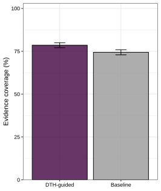
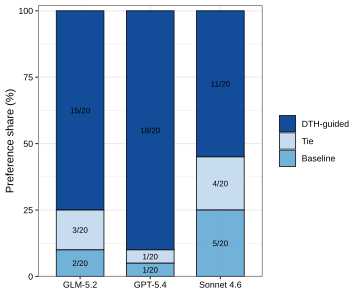
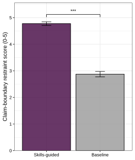
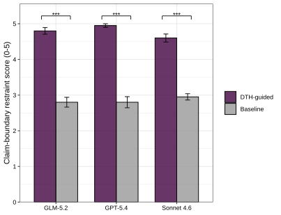

---
academic_writer_brief:
  section_scope: Methods, Results, and Discussion
  target_use: manuscript draft for DTH activation benchmarking
  disease: breast cancer
  benchmark_model: qwen3.5:397b-cloud
  benchmark_conditions: DTH-guided (DTH_yes) vs Baseline (DTH_no)
  valid_runs_per_condition: 20
  judge_models:
    - openai:gpt-5.4
    - anthropic:claude-sonnet-4-6
  output_language: English manuscript prose
  deep_interview_gate: completed; user request specified the section scope, reference folder, benchmark content, and dual-judge inclusion
run_reference_layers:
  structure_references:
    - /Users/jungj2/Dropbox/Metadata/aiagent/DeepMAST/docs/paper/SpatialAgent.md
    - /Users/jungj2/Dropbox/Metadata/aiagent/DeepMAST/docs/paper/STAgent.md
    - /Users/jungj2/Dropbox/Metadata/aiagent/DeepMAST/docs/paper/SPARK.pdf
    - /Users/jungj2/Dropbox/Metadata/aiagent/DeepMAST/docs/paper/MEDEA.pdf
  voice_references:
    - same_as_structure
  reference_use: discussion structure and agent-paper voice only; not used as benchmark evidence
  rag_health_check:
    status: skipped
    reason: direct local reference papers were provided
  benchmark_artifacts:
    - benchmarks/dth/results/cumulative_valid_only_summary_for_20each_target.json
    - benchmarks/dth/results/judge/dth_yes_no_gpt54_blind_summary.json
    - benchmarks/dth/results/judge/dth_yes_no_sonnet46_blind_summary.json
approval_status: direct_draft_requested_by_user
---

# DTH Skill Activation Benchmark: Methods, Results, and Discussion Draft

## Methods

### Breast cancer drug-target hypothesis-generation benchmark

We evaluated whether explicit activation of a drug-target-hypothesis (DTH) interpretation skill improved hypothesis-generation quality in a breast cancer drug-target assessment workflow. The benchmark used a fixed breast cancer evidence package containing prioritized target candidates, ligand-receptor candidates, malignant-cell pair evidence, gene-level target evidence, Open Targets target-disease evidence, known-drug annotations, and hypothesis-validation metadata. The featured target set used by the hypothesis writer comprised ERBB3, EPHB4, ERBB2, INSR, EFNB2, NECTIN4, and LAMA5.

Each run required the hypothesis writer to generate a valid hypothesis report from evidence already available in the input package. The report schema required 4-6 retained recommendations, coverage of the featured genes, at least one retained recommendation in each of four categories (Mechanism of Action, Therapeutic Strategy, Cross-Target Interaction, and Novel Pathway), evidence references restricted to loaded files, and cautious falsifiable predictions rather than clinical efficacy claims.

### Controlled DTH activation contrast

We compared two prompt conditions using the same model, source evidence, schema contract, save gate, and retry policy. In the Baseline condition (DTH_no), the hypothesis writer received only a minimal operational contract specifying allowed evidence-loading, reference-validation, and report-saving tools. The prompt explicitly stated that no skill guide was available and prohibited skill-file reads. In the DTH-guided condition (DTH_yes), the same minimal operational contract was used, but the writer was required to read exactly the DTH skill guide before drafting recommendations. Thus, the comparison isolated the effect of making the DTH interpretation guide available and mandatory while keeping the base prompt and output contract otherwise matched.

All benchmark generations were performed with qwen3.5:397b-cloud through the local Ollama interface. The analysis targeted 20 valid runs per condition. Runs were considered valid only when the process returned code 0, the generated hypothesis report passed schema and reference validation, the activation trace was valid, and no deterministic host-side fallback output was used. Initial failed exploratory runs were excluded from the valid-only analysis, and additional runs were collected until both conditions reached 20 valid outputs.

### Activation and quality auditing

For each valid run, we recorded whether the DTH skill was activated, whether host fallback was used, the evidence-coverage percentage, number of retained hypotheses, number of evidence references, retry-attempt count, and lexical evidence-use indicators. These indicators included Stage 1 evidence mentions, Stage 3 evidence mentions, Open Targets mentions, malignant-cell mentions, statements that explicitly marked findings as "not yet established", and causal-language usage. Category counts were aggregated across retained recommendations.

### Blinded dual-judge evaluation

To assess output quality beyond automated validity checks, we constructed 20 paired DTH_yes versus DTH_no comparisons from the valid output set. Within each pair, condition labels and generation-setting identifiers were hidden and the two reports were presented as anonymized outputs A and B. For consistency with the companion CCI skill-ablation benchmark, we used the same blinded dual-judge panel: gpt-5.4 accessed through the OpenAI API and claude-sonnet-4-6 accessed through the Anthropic API.

Each judge returned structured JSON for five 0-5 rubric axes: evidence grounding, biological plausibility, therapeutic relevance, claim-boundary restraint, and specificity/testability. The rubric also allowed an unsupported-claim penalty of 0, -1, or -2 and a major-error flag. For each output, the total score was the sum of the five positive axes plus the unsupported-claim penalty; a major error would subtract an additional 5 points. A pair was assigned to DTH_yes or DTH_no when the corresponding output exceeded the other by at least 2 total-score points, or to tie when the absolute difference was below this threshold and neither output had a unilateral major error. Judge outputs were validated for schema completeness before aggregation.

### Statistical analysis

Automated benchmark metrics were summarized over valid runs only. Evidence coverage was compared with a paired Wilcoxon signed-rank test using the matched DTH_yes and DTH_no run order. Paired judge preferences were summarized as win counts, win rates, mean total scores, mean rubric-axis scores, and confidence counts. For each judge separately, we used an exact two-sided sign test over non-tie pairs to test whether DTH_yes was preferred more often than DTH_no. For the main claim-boundary restraint analysis, scores were averaged across the two judges within each blinded pair and compared between DTH_yes and DTH_no with a paired Wilcoxon signed-rank test. Judge-stratified claim-boundary restraint tests were used as sensitivity analyses, with Bonferroni correction across the two judges. We additionally summarized a two-judge consensus preference by averaging total scores within each pair and applying the same two-point win threshold. Token usage and estimated API costs were recorded for both judges.

## Results

### The DTH contrast produced balanced valid output sets

The final benchmark contained 20 valid DTH-guided runs and 20 valid Baseline runs. All 40 included runs returned code 0, passed hypothesis validation, and had valid activation traces. DTH activation separated cleanly by condition: DTH-guided activated the DTH skill in 20 of 20 valid runs, whereas Baseline activated it in 0 of 20 valid runs. Host fallback was not used in any valid run. Native retry attempts were more concentrated at lower retry counts in DTH-guided (0 retries: 7 runs; 1 retry: 8; 2 retries: 5) than in Baseline (0, 1, 2, and 3 retries: 5 runs each).

**Table 1. Valid-run benchmark summary.**

| Condition | Valid runs | Validation passed | DTH activated | Host fallback used | Mean evidence coverage | Mean retained hypotheses | Mean evidence refs |
|---|---:|---:|---:|---:|---:|---:|---:|
| DTH-guided (DTH_yes) | 20/20 | 20/20 | 20/20 | 0/20 | 78.53 | 6.0 | 21.00 |
| Baseline (DTH_no) | 20/20 | 20/20 | 0/20 | 0/20 | 74.41 | 5.8 | 20.35 |

These data show that the benchmark successfully created a controlled activation contrast rather than a mixed or partially activated comparison.

### DTH activation increased evidence-boundary behavior

DTH-guided generation produced numerically higher mean evidence coverage than Baseline generation (78.53 versus 74.41), while both conditions had the same median evidence coverage (76.47) (Figure 3A). This coverage difference was borderline under the paired Wilcoxon signed-rank test (mean paired difference, +4.12 percentage points; P = 0.051). DTH-guided generation also produced more explicit references to evidence layers: mean Stage 1 mentions increased from 56.75 in Baseline to 68.60 in DTH-guided outputs, mean Stage 3 mentions increased from 21.75 to 29.35, and mean Open Targets mentions increased from 0.90 to 5.65. DTH-guided generation also produced more malignant-cell mentions (40.30 versus 29.95).

The largest automated separation was in boundary setting. DTH-guided outputs averaged 10.30 "not yet established" statements per valid report, whereas Baseline outputs averaged 0.00. Conversely, Baseline outputs used more causal language (3.60 versus 1.40 mean mentions). Category coverage remained broadly similar across conditions: DTH-guided generation produced 26 Cross-Target Interaction, 33 Mechanism of Action, 26 Novel Pathway, and 35 Therapeutic Strategy recommendations across valid runs, compared with 26, 35, 23, and 32 for Baseline generation. Thus, DTH activation did not simply increase output volume; it shifted reports toward more explicit evidence-layer citation and stronger separation between supported observations and unestablished causal interpretation.

### Blinded judges favored DTH-guided outputs, with model-dependent strength

The gpt-5.4 judge favored DTH-guided outputs in 18 of 20 pairs (90.0%), Baseline outputs in 1 pair (5.0%), and one tie (5.0%; non-tie sign-test P = 7.63e-05). The claude-sonnet-4-6 judge also favored DTH-guided outputs directionally, but more conservatively, selecting DTH-guided outputs in 11 pairs (55.0%), Baseline outputs in 5 pairs (25.0%), and ties in 4 pairs (20.0%; non-tie P = 0.210).

**Table 2. Blinded judge summary across two evaluators.**

| Judge | DTH-guided wins | Baseline wins | Ties | Mean score, DTH-guided | Mean score, Baseline | Delta | Non-tie sign-test P |
|---|---:|---:|---:|---:|---:|---:|---:|
| gpt-5.4 | 18 | 1 | 1 | 19.60 | 14.25 | +5.35 | 7.63e-05 |
| claude-sonnet-4-6 | 11 | 5 | 4 | 18.05 | 16.25 | +1.80 | 0.210 |

After averaging total scores across the two judges within each pair and applying the two-point win threshold, DTH-guided outputs were preferred in 14 of 20 paired comparisons, Baseline outputs in 1, and 5 pairs were ties. Considering all 40 judge-pair score comparisons, the DTH-guided score was higher in 30, lower in 6, and equal in 4, with a mean score delta of +3.58 and median delta of +4.00. Judge-level preference shares showed the same direction but different magnitudes across evaluators: DTH-guided outputs were preferred in 90% and 55% of pairs by gpt-5.4 and claude-sonnet-4-6, respectively (Supplementary Figure 3E). Thus, the dual-judge panel supported the DTH-guided condition, while also indicating that the effect size depends on the evaluator.

### The DTH advantage was concentrated in claim-boundary restraint

Rubric-axis means indicated that the largest and most consistent DTH-guided advantage was in claim-boundary restraint. After averaging scores across judges within each blinded pair, DTH-guided outputs had a higher mean claim-boundary restraint score than Baseline outputs (4.78 versus 2.88; mean paired difference, +1.90; paired Wilcoxon P = 8.13e-05) (Figure 3B). The judge-stratified DTH-guided minus Baseline difference on this axis was +2.15 for gpt-5.4 and +1.65 for claude-sonnet-4-6. This axis was significant for both judges under paired Wilcoxon signed-rank sensitivity tests after Bonferroni correction (adjusted P < 0.001 for each judge), and the judge-stratified display confirmed that the direction of the effect was consistent across both evaluators (Supplementary Figure 3D). DTH-guided outputs also reduced unsupported-claim penalties across judges and improved evidence grounding, although the magnitude varied by evaluator. In contrast, biological plausibility, therapeutic relevance, and specificity/testability showed smaller or inconsistent differences.

**Table 3. Judge-axis deltas for DTH-guided minus Baseline.**

| Judge | Evidence grounding | Biological plausibility | Therapeutic relevance | Claim-boundary restraint | Specificity/testability | Unsupported-claim penalty |
|---|---:|---:|---:|---:|---:|---:|
| gpt-5.4 | +1.05 | +0.30 | +0.15 | +2.15 | +0.05 | +0.90 |
| claude-sonnet-4-6 | +0.45 | -0.20 | -0.30 | +1.65 | -0.20 | +0.40 |
| Mean across judges | +0.75 | +0.05 | -0.07 | +1.90 | -0.07 | +0.65 |

This axis-level pattern suggests that the DTH skill most strongly improved scientific restraint and evidence-grounded interpretation, rather than uniformly increasing every quality dimension. Baseline outputs sometimes retained slightly more mechanistic or assay-level specificity, but this came with more unsupported causal framing and weaker separation between observed evidence and unestablished mechanistic claims.

## Figure Legends

### Main Figures

**Figure 3A: DTH-guided generation modestly increases evidence coverage.** Mean evidence coverage across 20 valid breast cancer hypothesis-generation runs per condition. Bars show mean coverage and error bars show the standard error of the mean. DTH-guided denotes the DTH_yes condition, in which the writer was required to read the drug-target-hypothesis guide before report generation; Baseline denotes the DTH_no condition, in which no skill guide was available. Evidence coverage was compared with a paired Wilcoxon signed-rank test over matched run order. The difference was borderline (mean paired difference, +4.12 percentage points; P = 0.051), and no significance marker is shown.

**Figure 3B: DTH-guided generation improves claim-boundary restraint in blinded judging.** Mean claim-boundary restraint scores from 20 blinded DTH-guided versus Baseline output pairs. For the main comparison, claim-boundary restraint scores from gpt-5.4 and claude-sonnet-4-6 were averaged within each pair before statistical testing. Bars show mean scores and error bars show the standard error of the mean across paired comparisons. Scores range from 0 to 5, with higher values indicating stronger separation between observed evidence, proposed mechanism, and unestablished causal or clinical claims. The DTH-guided condition showed higher claim-boundary restraint than Baseline (mean paired difference, +1.90; paired Wilcoxon signed-rank test, P = 8.13e-05). Asterisks indicate P < 0.001.

### Supplementary Figures

**Supplementary Figure 3D: The claim-boundary restraint advantage is consistent across blinded judges.** Judge-stratified claim-boundary restraint scores for the same 20 paired DTH-guided versus Baseline comparisons. Bars show mean scores and error bars show the standard error of the mean within each judge. Dark blue denotes DTH-guided outputs and light blue denotes Baseline outputs. Scores range from 0 to 5, with higher values indicating stronger restraint around causal and clinical claims. DTH-guided minus Baseline differences were +2.15 for gpt-5.4 and +1.65 for claude-sonnet-4-6. Paired Wilcoxon signed-rank tests were performed separately for each judge and Bonferroni-corrected across the two judges; all adjusted P values were <0.001. Asterisks indicate adjusted P < 0.001.

**Supplementary Figure 3E: Blind-judge preference shares favor DTH-guided reports across evaluators.** Stacked bar plots show the fraction of 20 blinded pairwise comparisons assigned to DTH-guided, tie, or Baseline by each judge. Segment labels indicate the number of pairs in each category. gpt-5.4 selected DTH-guided outputs in 18 of 20 pairs, ties in 1, and Baseline outputs in 1; claude-sonnet-4-6 selected DTH-guided outputs in 11 of 20 pairs, ties in 4, and Baseline outputs in 5. Pairwise preferences were assigned from blinded total-score differences using a two-point win threshold, with smaller absolute differences counted as ties.

## Discussion

This benchmark tested a focused question in agentic therapeutic hypothesis generation: whether a domain-specific interpretation skill changes the quality of an LLM-generated drug-target hypothesis report when the underlying evidence, output schema, save gate, and base operational prompt are held constant. Across 20 valid paired breast cancer runs, activating the DTH skill did not merely increase the amount of generated text or the number of retained recommendations. Instead, it shifted the writer toward a more evidence-bounded style of reasoning. DTH-guided reports more frequently cited Stage 1, Stage 3, Open Targets, and malignant-cell evidence layers; used fewer unsupported causal claims; and explicitly marked candidate mechanisms as not yet established. The dual-judge blinded evaluation supported this interpretation: both judges favored DTH-guided outputs on average, and the most consistent advantage was claim-boundary restraint rather than generic biological plausibility or testability.

These findings are consistent with a broader design principle emerging from recent biomedical agent systems: agent performance depends not only on model scale or tool access, but also on explicit control of intermediate reasoning, context, and verification. SpatialAgent and STAgent emphasize the ability of autonomous agents to orchestrate biological analysis workflows and synthesize interpretable scientific narratives from spatial data [1,2]. SPARK similarly frames agentic reasoning as a way to generate transparent biological concepts while controlling for hallucination through task framing and review steps [3]. MEDEA extends this principle to therapeutic discovery by combining planning, tool-grounded execution, literature assessment, and evidence reconciliation [4]. The present benchmark isolates a narrower mechanism within that larger design space. Rather than evaluating a full agent against a baseline system, it shows that a single loaded interpretation guide can alter the epistemic character of the final hypothesis report, especially by reducing overclaiming and making uncertainty visible.

The most important implication is that skill activation should not be evaluated only by coverage or throughput. In several development runs, DTH-enabled generation was slower and sometimes less stable than simpler prompting, and the final 20-run benchmark still showed that the primary gain was not a uniform increase across all quality axes. This is a useful distinction. For therapeutic hypothesis generation, a report that covers more evidence files but converts associative evidence into causal or clinical claims can be less scientifically useful than a report that is more cautious, even if less expansive. The DTH skill appears to function as an interpretation guardrail: it encourages the writer to separate observed evidence from proposed mechanism, therapeutic rationale from clinical efficacy, and candidate hypotheses from validated biology. This behavior is particularly relevant for drug-target workflows, where ligand-receptor signals, target-disease associations, and known-drug annotations can easily be over-integrated into claims that exceed the evidence.

The judge results also highlight the importance of multi-evaluator assessment. The gpt-5.4 judge strongly favored DTH-guided outputs, whereas claude-sonnet-4-6 showed the same direction but with a smaller and non-significant preference. This difference does not negate the benchmark signal; instead, it suggests that evaluator choice affects the apparent strength of the result. The two-judge consensus was strongest for claim-boundary restraint and reduced unsupported-claim penalties, which are precisely the axes most aligned with the intended role of the DTH skill. By contrast, small or inconsistent differences in biological plausibility, therapeutic relevance, and specificity/testability indicate that DTH should be described as improving scientific calibration rather than as universally improving every dimension of hypothesis quality.

Several limitations should be considered. First, the benchmark used one disease setting, one evidence package, and one generator model, qwen3.5:397b-cloud. Additional diseases, evidence structures, and model families will be needed to determine how broadly the DTH effect generalizes. Second, the analysis was valid-output only: initial failed exploratory runs were excluded, and all reported comparisons required successful schema validation, valid activation traces, and no host-side deterministic fallback. This design cleanly isolates output quality among successful runs, but it does not measure full production reliability. Third, the contrast used a deliberately minimal operational prompt to isolate DTH skill activation. This makes the causal contrast clearer, but production prompts may contain overlapping guidance that reduces the visible separation between DTH_yes and DTH_no. Fourth, the blinded evaluators were LLM judges rather than domain-expert therapeutic biologists. Although the rubric was structured and judge outputs were schema-validated, human expert review and experimental validation remain necessary before interpreting any generated target hypothesis as biologically actionable.

Future work should extend this benchmark in three directions. First, the same DTH-guided versus Baseline contrast should be repeated under the current production prompt to test whether the skill continues to improve claim calibration when the base writer already contains stronger operational guidance. Second, the benchmark should be expanded across model scales, including smaller local models and stronger cloud models, to distinguish skill effects from model-capability effects. Third, downstream validation should move beyond report-level judging toward perturbation-centered evidence: whether DTH-guided hypotheses yield more precise experimental predictions, better target prioritization, or clearer falsification plans. In production settings, failure handling should also remain explicit. Native retries can preserve the LLM-written hypothesis path, whereas deterministic fallback should be marked as degraded recovery rather than counted as a successful DTH output.

Overall, this benchmark supports the view that skill loading can improve biomedical agent outputs by changing how evidence is interpreted, not simply by adding more information. The DTH skill made the hypothesis writer more conservative in the scientifically useful sense: it increased evidence-layer awareness, reduced unsupported causal framing, and made the boundary between observation and hypothesis more explicit. This provides a concrete, measurable mechanism by which modular domain skills can improve agentic therapeutic discovery workflows.

### Source and reproducibility artifacts

The manuscript prose above intentionally avoids local path dependencies. The underlying reproducibility artifacts are:

| Artifact | Path |
|---|---|
| Breast cancer input data | `/Users/jungj2/Dropbox/Metadata/aiagent/DeepMAST/res_bc_drugtarget` |
| Valid-run cumulative summary | `benchmarks/dth/results/cumulative_valid_only_summary_for_20each_target.json` |
| Human-readable valid-run summary | `benchmarks/dth/results/cumulative_valid_only_summary_for_20each_target.md` |
| DTH_no prompt | `benchmarks/dth/inputs/prompt_used_DTH_no_operational_contract_minimal.txt` |
| DTH_yes prompt | `benchmarks/dth/inputs/prompt_used_DTH_yes_operational_contract_minimal_plus_dth.txt` |
| GPT-5.4 judge summary | `benchmarks/dth/results/judge/dth_yes_no_gpt54_blind_summary.json` |
| Claude Sonnet 4.6 judge summary | `benchmarks/dth/results/judge/dth_yes_no_sonnet46_blind_summary.json` |
| Blinded judge script | `benchmarks/dth/scripts/judge_dth_yes_no_blind.py` |
| Figure 3A evidence coverage | `benchmarks/dth/figures/Fig3A_DTH_EvidenceCoverage.svg` |
| Figure 3B claim-boundary restraint | `benchmarks/dth/figures/Fig3B_DTH_BlindJudgeRigor.svg` |
| Supplementary Figure 3D judge-stratified claim-boundary restraint | `benchmarks/dth/figures/FigS3D_DTH_BlindJudgeRigorByJudge.svg` |
| Supplementary Figure 3E blind-judge preference shares | `benchmarks/dth/figures/FigS3E_DTH_BlindJudgeWinRate.svg` |

## References

[1] DOI: 10.1101/2025.04.03.646459. "SpatialAgent: An autonomous AI agent for spatial biology."

[2] DOI: 10.1101/2025.04.01.646731. "Spatial transcriptomics AI agent charts hPSC-pancreas maturation in vivo."

[3] DOI: 10.1038/s41591-026-04357-y. "An agentic framework for autonomous scientific discovery in cancer pathology."

[4] DOI: 10.64898/2026.01.16.696667. "MEDEA: An omics AI agent for therapeutic discovery."
