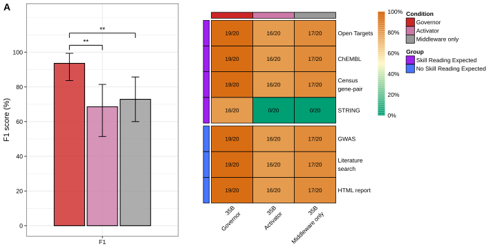
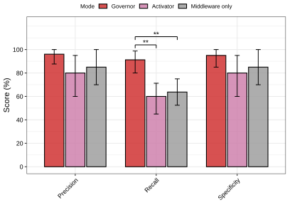

# Selective8 Lung/IPF 35B Skill-Activation Benchmark: Methods and Results Draft

## Academic Writer Brief

**Target result**: Draft manuscript-ready Methods and Results text for the Lung/IPF `qwen3.5:35b` selective8 benchmark, including the F1-only main figure, the Precision/Recall/Specificity supplemental figure, the benchmarking protocol, and statistical analysis.

**Section types**: Methods and Results.

**Scope included**: `qwen3.5:35b`; Lung/IPF frozen evidence workspace; three activation configurations (`Middleware only`, `Activator`, and `Governor`); 20 runs per condition; seven scored skills; main Figure 3 F1-only panel plus seven-skill heatmap; supplemental Precision/Recall/Specificity bar graph.

**Reference layers**: No external structure or voice/tone reference paper was provided for this run. This draft uses repo-local benchmark outputs and the existing Methods/Results writing patterns only.

**Open questions**: Target journal, exact figure numbering in the final manuscript, and exact Ollama/model build metadata remain to be finalized.

## Methods

### Selective8 hypothesis-generation benchmark

We evaluated whether an explicit skill-governance layer improved selective skill reading during DeepMAST hypothesis generation. The benchmark used a frozen Lung/IPF drug-target evidence workspace (`docs/benchmarks/tmp/res_ipf_drugtarget_tmp`) and ran the production `hypothesis_writer` workflow under three activation configurations: `Middleware only`, `Activator`, and `Governor`. In the `Middleware only` configuration, the selective skill registry was exposed through the middleware without an additional activation policy. In the `Activator` configuration, the middleware was supplemented with the skill activator. In the `Governor` configuration, the middleware was supplemented with the Governor activation policy. All runs used `qwen3.5:35b` through the local Ollama setup configured for ports 5000, 6000, and 7000. The completed result file records 20 attempts per condition and 60 total attempts.

The benchmark used the `selective8` hypothesis-writer skill set. The full registry contained `drug-target-hypothesis`, `opentargets-database`, `chembl-database`, `compare-census-gene-pair-by-cell-type`, `string-database`, `gwas-database`, `biomedical-literature-search`, and `html-report-generator`. Because the `drug-target-hypothesis` skill was directly required by the hypothesis-writer prompt, it was excluded from the selective activation score to avoid conflating prompt-forced skill reading with condition-dependent selective activation. The scored seven-skill panel therefore included four expected-active skills (`opentargets-database`, `chembl-database`, `compare-census-gene-pair-by-cell-type`, and `string-database`) and three expected-inactive negative controls (`gwas-database`, `biomedical-literature-search`, and `html-report-generator`).

Each trial generated a hypothesis report from the same frozen evidence workspace. Deterministic host-side hypothesis fallback was disabled (`host_hypothesis_fallback = off`) so that validation failures remained visible rather than being recovered by a template-like fallback path. Native hypothesis-writer retry was enabled with `DRUG_TARGET_GRAPH_HYPOTHESIS_RETRY = 1`, `DRUG_TARGET_HYPOTHESIS_MAX_QUALITY_RETRIES = 3`, `DRUG_TARGET_HYPOTHESIS_RETRY_TIMEOUT_SECONDS = 1200`, and `DRUG_TARGET_ALLOW_HYPOTHESIS_RETRY_AFTER_BUDGET_ABORT = 1`. Thus, failed or budget-aborted native writer attempts could be retried by the hypothesis writer, but attempts that still failed validation after retry were counted as failures.

### Activation scoring and visualization

Skill activation was extracted from each trial's activation trace by reading the activated skill names recorded during hypothesis generation. For each run, expected-active skills read by the workflow were counted as true positives, expected-active skills not read were counted as false negatives, expected-inactive skills read were counted as false positives, and expected-inactive skills not read were counted as true negatives. Precision, recall, specificity, and F1 were computed from these counts. A selective exact match required all four expected-active skills to be read and none of the three negative-control skills to be read.

All 20 attempts per condition were retained in the denominator. Runs that failed final validation were not removed. For the bar-plot point estimates, a validation-failed run contributed zero true positives and zero true negatives, and was encoded as four false negatives and three false positives. For paired repeat-level statistical testing, validation-failed runs were assigned zero metric credit. This conservative scoring made validation failure reduce the activation score rather than disappear from the analysis.

The main figure was generated as a publication-style two-panel figure. Panel A reports F1 score only, with the previous Precision, Recall, and Specificity bars moved to the supplemental figure. Panel B reports seven-skill correctness as a heatmap, where each cell is the number of correct runs out of 20 for a given condition and skill. The supplemental figure reports Precision, Recall, and Specificity as grouped bar plots. Point estimates and 95% confidence intervals were generated with 2,000 non-parametric bootstrap resamples over attempts. Benchmark scripts were run with Python 3.12.10. Figures were generated in R 4.4.0 using `ggplot2` 4.0.0, `dplyr` 1.1.4, `cowplot` 1.2.0, `pheatmap` 1.0.13, `jsonlite` 2.0.0, `purrr` 1.1.0, `tidyr` 1.3.1, `tibble` 3.3.0, and `scales` 1.4.0.

### Statistical analysis

The primary statistical endpoint for the main figure was repeat-level F1 across the three activation configurations. Because the same repeat indices were compared across conditions and the metric distribution was bounded and non-Gaussian, significance was tested with a Friedman omnibus test followed by paired Wilcoxon signed-rank post hoc tests. Pairwise p-values were adjusted with the Holm method across the three condition comparisons for each metric. The same metric-specific testing framework was applied to Precision, Recall, and Specificity in the supplemental figure. Only Holm-adjusted significant comparisons were annotated on the figures, using `*` for `p <= 0.05`, `**` for `p <= 0.01`, and `***` for `p <= 0.001`.

## Results

### Governor improved selective skill activation in the Lung/IPF 35B benchmark

To determine whether explicit skill governance improved selective skill reading during hypothesis generation, we compared `Middleware only`, `Activator`, and `Governor` on 20 Lung/IPF trials per condition. The validation pass rates were 17/20 for `Middleware only`, 16/20 for `Activator`, and 19/20 for `Governor`. After retaining validation-failed runs as zero-credit attempts, `Governor` achieved the highest F1 score (93.6%; 95% bootstrap CI, 83.7-99.4), compared with `Middleware only` (72.9%; 95% CI, 60.0-85.7) and `Activator` (68.6%; 95% CI, 51.4-81.4) (Figure 3A).

The improvement in F1 was statistically significant across the three conditions (Friedman test, `n = 20` paired repeats, statistic = 23.3103, `df = 2`, `p = 8.6741e-06`). In post hoc paired Wilcoxon signed-rank tests with Holm correction, `Governor` outperformed both `Activator` (`p_adj = 0.0055`) and `Middleware only` (`p_adj = 0.0055`), whereas `Activator` did not differ from `Middleware only` (`p_adj = 0.7768`). These results show that the Governor condition increased the primary selective-activation score relative to both non-governed configurations.

### Governor primarily recovered the missing STRING activation without increasing negative-control activation

The seven-skill heatmap showed that the F1 improvement was driven by improved recovery of an expected-active skill that was consistently missed by the two non-governed configurations. `Middleware only` correctly activated `opentargets-database`, `chembl-database`, and `compare-census-gene-pair-by-cell-type` in 17/20 runs each, but did not correctly activate `string-database` in any run (0/20). `Activator` showed the same pattern at a lower validation pass rate, with 16/20 correct runs for `opentargets-database`, `chembl-database`, and `compare-census-gene-pair-by-cell-type`, and 0/20 for `string-database`. In contrast, `Governor` correctly activated `opentargets-database`, `chembl-database`, and `compare-census-gene-pair-by-cell-type` in 19/20 runs each and recovered `string-database` in 16/20 runs (Figure 3B).

Negative-control skill suppression remained high across the benchmark. After validation-failed runs were penalized as zero-credit attempts, `gwas-database`, `biomedical-literature-search`, and `html-report-generator` were correctly not activated in 17/20 `Middleware only` runs, 16/20 `Activator` runs, and 19/20 `Governor` runs. Selective exact matches were therefore 0/20 for `Middleware only`, 0/20 for `Activator`, and 16/20 for `Governor`. Together, these results indicate that the Governor condition improved the main selective-activation endpoint by increasing expected-active skill coverage, particularly `string-database`, while maintaining negative-control exclusion.

### Supplemental metrics showed that the F1 gain was driven by recall rather than precision or specificity

To clarify which component of F1 changed across conditions, we separated Precision, Recall, and Specificity into a supplemental bar plot. `Governor` had the highest point estimates for all three metrics: Precision was 96.1% for `Governor`, 85.0% for `Middleware only`, and 80.0% for `Activator`; Recall was 91.2% for `Governor`, 63.8% for `Middleware only`, and 60.0% for `Activator`; and Specificity was 95.0% for `Governor`, 85.0% for `Middleware only`, and 80.0% for `Activator` (Supplementary Figure 1).

Metric-specific statistical testing showed that only Recall reproduced the main F1 significance pattern. Recall differed across conditions by Friedman test (`n = 20`, statistic = 23.3103, `df = 2`, `p = 8.6741e-06`), and `Governor` exceeded both `Activator` (`p_adj = 0.0055`) and `Middleware only` (`p_adj = 0.0055`) after Holm correction. Precision did not differ significantly across conditions (Friedman statistic = 1.7500, `df = 2`, `p = 0.4169`), and neither did Specificity (Friedman statistic = 1.7500, `df = 2`, `p = 0.4169`). These results show that the main F1 improvement was primarily attributable to improved recall of expected-active skills rather than a statistically significant gain in negative-control suppression.

## Figure Legends

### Main Figures

**Figure 3: Governor improves F1-based selective skill activation in the Lung/IPF 35B benchmark.** (A) F1 score for seven scored skills across `Governor`, `Activator`, and `Middleware only` configurations in the Lung/IPF `qwen3.5:35b` benchmark. Bars show aggregate F1 across 20 attempts per condition after retaining validation-failed runs as zero-credit attempts; error bars show 95% bootstrap confidence intervals from 2,000 resamples. Statistical annotations show Holm-adjusted paired Wilcoxon signed-rank tests after a Friedman omnibus test over paired repeats. (B) Seven-skill correctness heatmap. Rows show the four expected-active skills (`Open Targets`, `ChEMBL`, `Census gene-pair`, and `STRING`) and the three negative-control skills (`GWAS`, `Literature search`, and `HTML report`). Columns show activation configurations. Cell labels indicate correct runs out of 20. The directly prompted `drug-target-hypothesis` skill was excluded from scoring.

### Supplementary Figures

**Supplementary Figure 1: Precision, Recall, and Specificity components of selective skill activation.** Grouped bar plots show Precision, Recall, and Specificity for `Governor`, `Activator`, and `Middleware only` in the Lung/IPF `qwen3.5:35b` benchmark. Bars retain all 20 attempts per condition and score validation-failed runs as zero-credit attempts; error bars show 95% bootstrap confidence intervals from 2,000 resamples. Metric-specific Friedman tests followed by Holm-adjusted paired Wilcoxon signed-rank tests were applied separately to Precision, Recall, and Specificity. Significant pairwise differences were observed for Recall only.

## Reproducibility Artifacts

- Benchmark result directory: `docs/benchmarks/hypothesis_generation_consistency/results/selective8_lung35_native_retry3_retryafterbudget_9run_20260615_135409`
- Benchmark result JSON: `docs/benchmarks/hypothesis_generation_consistency/results/selective8_lung35_native_retry3_retryafterbudget_9run_20260615_135409/benchmark_results.json`
- Seven-skill activation summary: `docs/benchmarks/hypothesis_generation_consistency/results/selective8_lung35_native_retry3_retryafterbudget_9run_20260615_135409/selective7_activation_summary.json`
- Metric-specific significance summary: `docs/benchmarks/hypothesis_generation_consistency/figures/selective8_governor_vs_middleware_skill_fig3_selective7_significance_summary.json`
- Figure script: `docs/benchmarks/hypothesis_generation_consistency/figures/selective8_governor_vs_middleware_skill_fig3.R`
- Main figure: `docs/benchmarks/hypothesis_generation_consistency/figures/selective8_governor_vs_middleware_skill_fig3_lung_35b.svg`
- Supplementary figure: `docs/benchmarks/hypothesis_generation_consistency/figures/suppl_selective8_governor_vs_middleware_skill_fig3_lung_35b.svg`
- Benchmark runner: `docs/benchmarks/hypothesis_generation_consistency/run_governor_production_activation_matrix.py`
- Activation trace analyzer: `docs/benchmarks/hypothesis_generation_consistency/analyze_selective_activation_traces.py`

## Open Questions Before Manuscript Finalization

- Confirm final figure numbering: this draft assumes the main figure is `Figure 3` and the Precision/Recall/Specificity plot is `Supplementary Figure 1`.
- Confirm whether the final Results should report bootstrap confidence intervals numerically in text or only display them in the figure.
- Add exact Ollama build/model checkpoint metadata if required by the target journal: `[needs: Ollama version and qwen3.5:35b model digest/build metadata]`.
- Confirm whether to call the benchmark context `Lung/IPF`, `IPF`, or `pulmonary fibrosis` consistently across the full manuscript.
- Confirm whether the Methods should include the exact command line used to launch the 20-run benchmark in the supplement.
