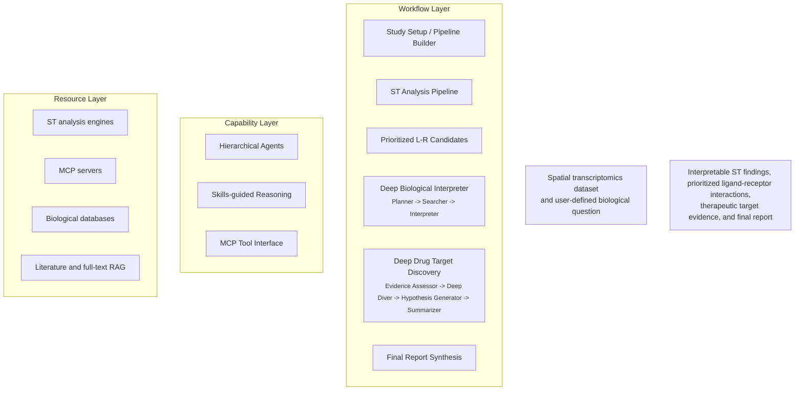

# DeepMAST Figure 1 Implementation Plan

> **For Claude:** REQUIRED SUB-SKILL: Use superpowers:executing-plans to implement this plan task-by-task.

**Goal:** Build an editable Figure 1 wireframe for DeepMAST, export it as SVG, and prepare it for final manuscript polishing.

**Architecture:** The figure will be created as a layered Mermaid source of truth, then exported to SVG and reviewed against the approved design document. The workflow layer will show the scientific pipeline, while the capability and resource layers will expose the skills-guided architecture substrate without overwhelming the main narrative.

**Tech Stack:** Mermaid, SVG export, Markdown design docs, git

---

### Task 1: Create the Figure 1 source file

**Files:**
- Create: `fig/deepmast_figure1_overview.mermaid`
- Reference: `docs/plans/2026-04-03-deepmast-figure1-design.md`
- Reference: `fig/skills_mcp_combined.mermaid`

**Step 1: Write the first Mermaid wireframe**

Create `fig/deepmast_figure1_overview.mermaid` with:



**Step 2: Check the new file exists and is readable**

Run: `sed -n '1,220p' fig/deepmast_figure1_overview.mermaid`
Expected: Mermaid source prints without truncation or shell errors.

**Step 3: Commit**

```bash
git add fig/deepmast_figure1_overview.mermaid
git commit -m "docs: add DeepMAST figure 1 mermaid wireframe"
```

### Task 2: Add workflow and capability connections

**Files:**
- Modify: `fig/deepmast_figure1_overview.mermaid`
- Reference: `docs/plans/2026-04-03-deepmast-figure1-design.md`

**Step 1: Add the approved main workflow arrows**

Add:

```mermaid
INPUT --> SETUP --> ST --> LR
LR --> DBI
LR --> DDTD
DBI --> SYN
DDTD --> SYN
SYN --> OUT
```

**Step 2: Add dashed capability support arrows**

Add:

```mermaid
AG -.-> SETUP
AG -.-> DBI
AG -.-> DDTD
AG -.-> SYN
SK -.-> DBI
SK -.-> DDTD
MCP -.-> ST
MCP -.-> DDTD
```

**Step 3: Run a quick source review**

Run: `sed -n '1,260p' fig/deepmast_figure1_overview.mermaid`
Expected: The file shows both the main workflow arrows and dashed support arrows.

**Step 4: Commit**

```bash
git add fig/deepmast_figure1_overview.mermaid
git commit -m "docs: add workflow and capability edges to DeepMAST figure 1"
```

### Task 3: Add layer styling and manuscript-friendly labels

**Files:**
- Modify: `fig/deepmast_figure1_overview.mermaid`

**Step 1: Add style classes**

Add style definitions similar to:

```mermaid
classDef workflow fill:#eef4ff,stroke:#6c8ebf,stroke-width:2px,color:#1f2933;
classDef artifact fill:#f7f7f7,stroke:#9aa4b2,stroke-width:1.5px,color:#1f2933;
classDef capability fill:#eef9f0,stroke:#81c784,stroke-width:1.5px,color:#1f2933;
classDef resource fill:#fff8e8,stroke:#ffcc80,stroke-width:1.5px,color:#1f2933;
classDef io fill:#ffffff,stroke:#9aa4b2,stroke-width:1.5px,color:#1f2933;
```

**Step 2: Assign classes**

Apply:

```mermaid
class SETUP,ST,DBI,DDTD,SYN workflow
class LR artifact
class AG,SK,MCP capability
class ENG,MS,DB,RAG resource
class INPUT,OUT io
```

**Step 3: Add small notes without overcrowding**

Keep only:

- one small note inside `SYN`: `drug-target outputs incorporated into final synthesis`
- no extra explanatory paragraphs inside boxes

**Step 4: Review for visual density**

Run: `sed -n '1,320p' fig/deepmast_figure1_overview.mermaid`
Expected: Labels remain short enough for a single-figure overview.

**Step 5: Commit**

```bash
git add fig/deepmast_figure1_overview.mermaid
git commit -m "docs: style DeepMAST figure 1 wireframe for manuscript layout"
```

### Task 4: Export the Mermaid wireframe to SVG

**Files:**
- Create: `fig/deepmast_figure1_overview.svg`
- Modify: `fig/deepmast_figure1_overview.mermaid`

**Step 1: Render to SVG**

Run one of these:

```bash
mmdc -i fig/deepmast_figure1_overview.mermaid -o fig/deepmast_figure1_overview.svg
```

or, if `mmdc` is unavailable:

```bash
npx @mermaid-js/mermaid-cli -i fig/deepmast_figure1_overview.mermaid -o fig/deepmast_figure1_overview.svg
```

Expected: `fig/deepmast_figure1_overview.svg` is created successfully.

**Step 2: Verify the SVG exists**

Run: `ls -lh fig/deepmast_figure1_overview.svg`
Expected: One SVG file with non-zero size.

**Step 3: Commit**

```bash
git add fig/deepmast_figure1_overview.svg fig/deepmast_figure1_overview.mermaid
git commit -m "docs: export DeepMAST figure 1 wireframe as SVG"
```

### Task 5: Add the approved legend and handoff notes

**Files:**
- Create: `fig/deepmast_figure1_caption.md`
- Reference: `docs/plans/2026-04-03-deepmast-figure1-design.md`

**Step 1: Write the caption file**

Create:

```markdown
DeepMAST is a layered multi-agent system that translates spatial transcriptomics data and user-defined biological questions into interpretable findings and therapeutic target evidence. The workflow layer comprises study setup, standardized ST analysis, candidate ligand-receptor prioritization, deep biological interpretation, deep drug target discovery, and final report synthesis. Beneath this workflow, a capability layer highlights hierarchical agents, skills-guided reasoning, and MCP-based tool invocation, while a resource layer provides access to ST analysis engines, MCP servers, biological databases, and literature/full-text RAG resources. This design emphasizes DeepMAST’s core strength as a skills-guided scientific agent system rather than a tool-calling pipeline alone.
```

**Step 2: Verify the caption file**

Run: `sed -n '1,120p' fig/deepmast_figure1_caption.md`
Expected: The full legend appears as a single paragraph with no placeholder text.

**Step 3: Commit**

```bash
git add fig/deepmast_figure1_caption.md
git commit -m "docs: add caption for DeepMAST figure 1"
```

### Task 6: Final figure QA review

**Files:**
- Review: `fig/deepmast_figure1_overview.mermaid`
- Review: `fig/deepmast_figure1_overview.svg`
- Review: `fig/deepmast_figure1_caption.md`
- Reference: `docs/plans/2026-04-03-deepmast-figure1-design.md`

**Step 1: Compare the rendered figure against the approved design**

Checklist:

- Workflow layer dominates visually
- `Skills-guided Reasoning` is the most prominent capability box
- `Prioritized L-R Candidates` is shown as an artifact, not an agent
- `Deep Biological Interpreter` and `Deep Drug Target Discovery` converge into `Final Report Synthesis`
- No standalone `Hybrid L-R Prioritization` agent box appears

**Step 2: Run one final status check**

Run: `git status --short`
Expected: Only intended figure files are modified or staged.

**Step 3: Commit**

```bash
git add fig/deepmast_figure1_overview.mermaid fig/deepmast_figure1_overview.svg fig/deepmast_figure1_caption.md
git commit -m "docs: finalize DeepMAST figure 1 overview assets"
```
